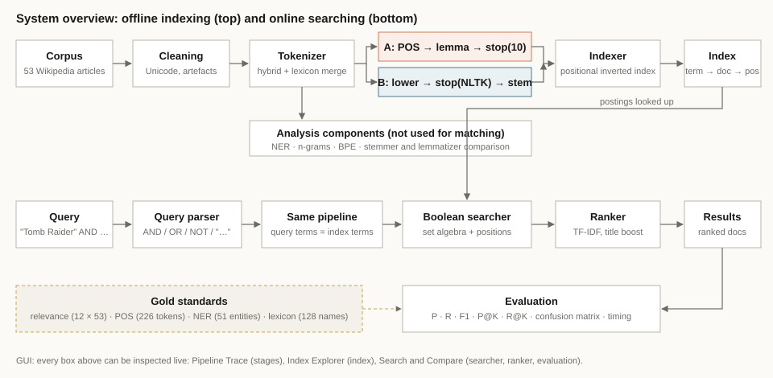
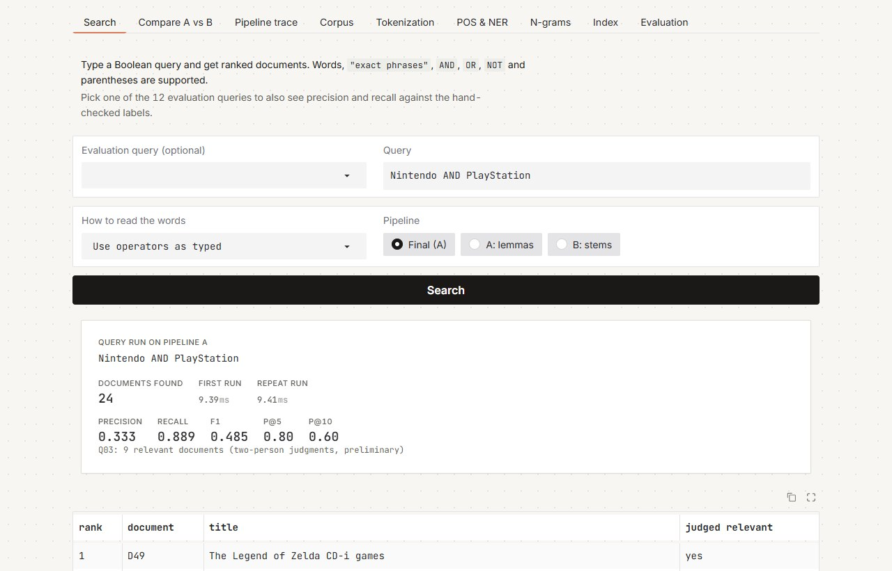
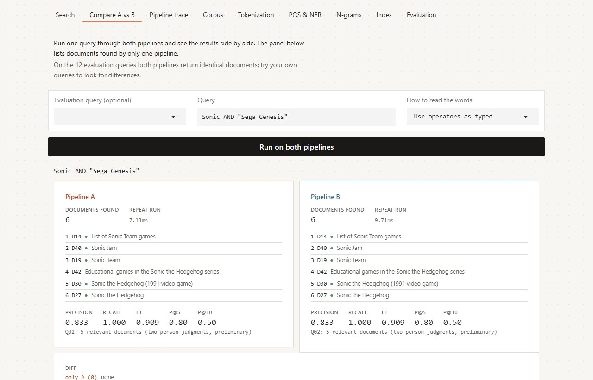
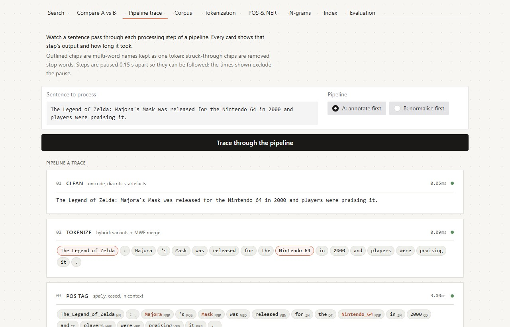
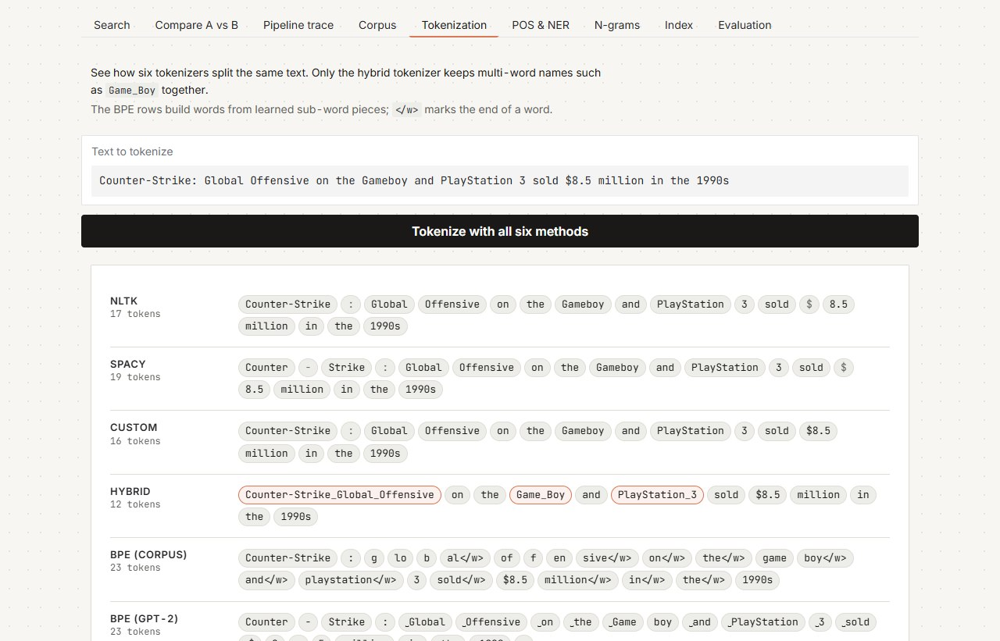
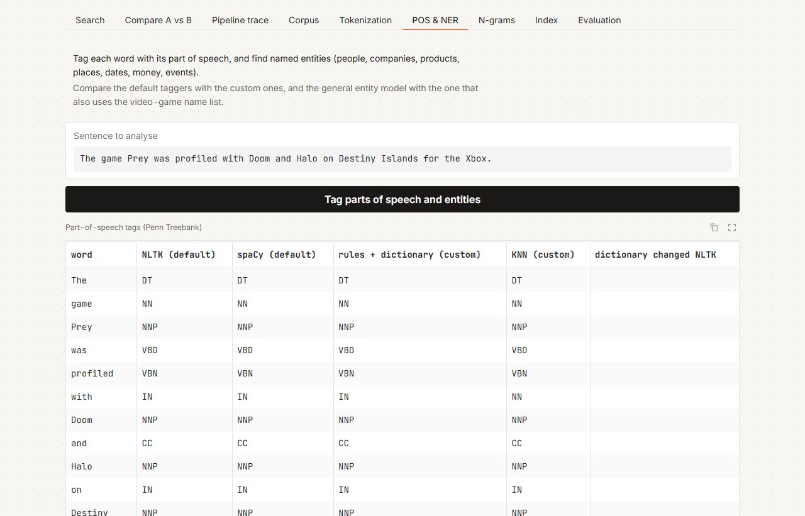
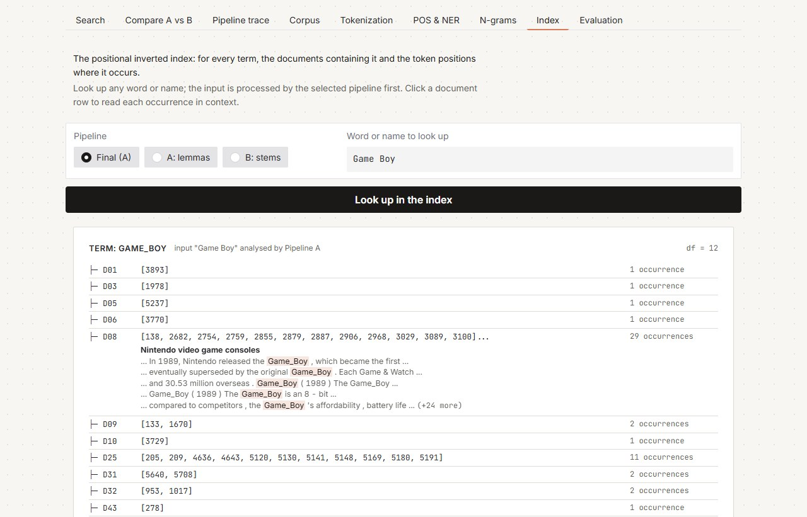
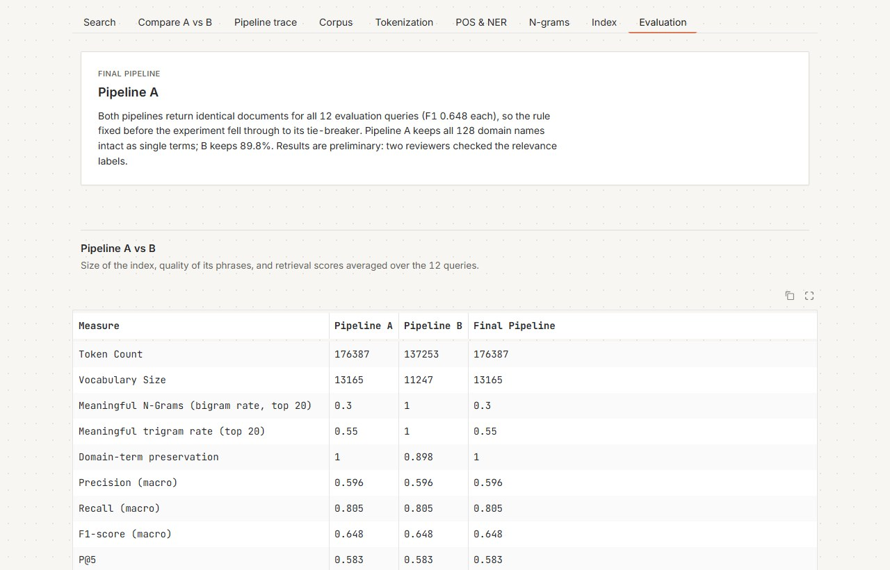

# A Search Engine for Video-Game Knowledge: Text Analysis, Indexing and Boolean Retrieval

**Authors:** Priyanka B, Sachin B, Tiya P, Vaidhav A.

**Course code:** DATA403, Natural Language Processing, Assessment-1, Vidyashilp University. **Date:** October 2026.

**Materials:**

- **Code:** `Domain_Text_Analysis_Retrieval.ipynb`, one executed notebook, built on the library `vgir.py`.
- **Data:** `data/`.
- **Results:** `results/`. Every number in this report comes from a file named in brackets.
- **Design record:** `docs/PREREGISTRATION.md`, written before any results, and `docs/DECISION_LOG.md`, every decision and change since.

## Summary

We built a small search engine for video games, from raw Wikipedia text to a working searcher with a graphical interface, and measured how well every stage works.

**In plain terms.** A search engine does two jobs:

- **Ahead of time, the indexer** reads every document and builds a lookup table, like the index at the back of a book. For each word it lists the documents and positions where it occurs.
- **At question time, the searcher** looks words up in that table, combines the lists with AND, OR and NOT, and ranks what is left.

Everything between the raw text and the index decides which "words" exist in the first place:

- **Tokenizing:** cutting text into pieces.
- **Normalising:** making *released* and *releases* look alike.
- **Filtering:** dropping words like *the*.

Most of this report is about those decisions, and about measuring whether each one helps.

**What we built:**

- **A corpus** of 53 English Wikipedia articles about video games, taken from the judged pools of 12 questions in the public MIRACL retrieval dataset.
- **Every major text-processing technique**, implemented and measured on the corpus: four tokenizers, two kinds of subword (BPE) tokenization, stop-word lists, three stemmers, three lemmatizers, five part-of-speech taggers, two named-entity recognisers and n-grams of length 1 to 5.
- **Two complete processing pipelines**, which apply the same ideas in a different order:
  - **Pipeline A** analyses grammar first, then reduces words to dictionary forms.
  - **Pipeline B** normalises first, then chops words to stems.
- **A positional inverted index** for each pipeline, and a **Boolean searcher** (keyword, phrase, AND, OR, NOT) that ranks its results.
- **Evaluation of every stage against a gold standard** (hand-checked correct answers) with accuracy, precision, recall, F1 and confusion matrices. For search, every one of the 636 query–document pairs was judged.
- **A GUI** that works as a real search tool and shows the intermediate results of every stage.

**What we found:**

- **Tokenization matters most.** For this domain the decisive component is the tokenizer that keeps multi-word names like *Super Nintendo Entertainment System* together. Only our hybrid tokenizer keeps all 91 such names in the lexicon as single tokens; NLTK, spaCy and a plain regex tokenizer keep none.
- **The two pipelines retrieve identically.** They return the same documents for all 12 test queries (precision 0.596, recall 0.805, F1 0.648, averaged over queries). They still differ in the index they build:

  | | Pipeline A | Pipeline B |
  |---|---|---|
  | Index tokens | 176,387 | 137,253 |
  | Vocabulary | 13,165 terms | 11,247 terms |
  | Domain names kept intact | 100% | 89.8% |

- **Pipeline A is the final pipeline,** chosen by the decision rule fixed before the experiment: with no F1 difference, the rule falls back to domain-name preservation.
- **Accuracy is the wrong metric for search.** The searcher scores 0.898 accuracy, but a system that returns nothing would score 0.910, because almost every document is irrelevant to almost every query. Precision and recall show what accuracy hides.

**Status of the results.** The search results are *preliminary*: two people checked the relevance labels, not the four originally planned. An earlier run with automatically worded queries favoured Pipeline B; section 5.6 explains why that happened and why it came from a single query.

## How to read this report

Each component is explained twice:

- **In plain terms:** what it does and why, with an everyday analogy.
- **How it works:** the exact method, its parameters and its place in the pipeline.

Results follow each explanation, together with the gold standard and metric used to judge them. Section 2 gives the whole system on one page. Appendix A maps every item of the assignment brief to the section that answers it.

Two labels are used throughout:

- **Confirmatory** results test hypotheses written down before the experiment (H1–H6).
- **Exploratory** results are everything else. They are labelled so that nothing found after the fact is presented as if it had been predicted.

---

# 1. The problem and the domain

## 1.1 What we set out to do

**In plain terms.** If you ask "Who wrote the Zelda theme song?", a search engine should hand you the few articles that can answer it. Doing that well means understanding text at several levels:

- what counts as a word (*Zelda's*? *Counter-Strike*?);
- which words mean the same thing (*released*, *releasing*);
- which words carry meaning at all (*the* does not);
- which words are names (*Metroid* is a game, not a person).

We built each of these capabilities, put them in two different orders, and measured the effect.

**How it works.** The project follows the sequence *select, order, implement, compare, evaluate, justify*. We treated it as a small controlled experiment. Before any results existed, we wrote down:

- two research questions;
- six hypotheses;
- the definitions of both pipelines;
- all metrics;
- a rule for choosing the final pipeline.

This is the preregistration (`docs/PREREGISTRATION.md`, frozen 29.09.2026). Every later change was recorded as a dated amendment in the decision log rather than made silently.

**Research questions:**

- **RQ1.** Does an annotate-first, lemma-based pipeline (A) or a normalise-first, stem-based pipeline (B) retrieve better on video-game queries?
- **RQ2.** Which components explain any difference: title-preserving tokenization, POS-aware lemmatization, or the size of the stop list?

## 1.2 Why use an existing dataset (DEC-000)

**In plain terms.** To score a search engine you need an answer key: for each question, which documents are relevant. Writing that key yourself is easy to bias, because you know what your system will find. So we started from a public dataset whose answer key was made by other people.

**How it works.** We chose **MIRACL English** (Zhang et al., 2023), a public, versioned (Apache-2.0) retrieval dataset. In MIRACL, human annotators judged which Wikipedia passages answer natural-language questions; these judgments are called *qrels*. The alternatives considered were:

- **Natural Questions, HotpotQA, DBpedia-Entity, FEVER, Climate-FEVER:** the same open-domain problem as MIRACL, with sparser judgments.
- **TREC-COVID:** a better domain fit with deeper judgments. It was kept as the fallback in case no MIRACL topic qualified.

MIRACL covers all of Wikipedia, so we then chose one theme inside it to make the system domain-specific.

## 1.3 Why video games (DEC-001, EXP-00)

**In plain terms.** We scanned MIRACL for themes with enough questions and enough judged articles, and picked by a preference order fixed beforehand. Video games won, partly because its text is full of the things that trouble generic NLP tools: names made of ordinary words, numbers inside names, and spelling variants.

**How it works.** A theme qualified if it had:

- at least 15 usable questions;
- at least 10 questions with two or more relevant passages;
- at least 50 judged articles;
- enough overlap between questions (at least 20% sharing an article, or at least 50% sharing a content word).

All five scanned themes qualified (EXP-00, exploratory):

| Theme | Usable questions | Questions with at least 2 relevant passages | Judged articles | Share an article | Share a word |
|---|---|---|---|---|---|
| medicine/health | 140 | 106 | 852 | 55.7% | 84.3% |
| **video games** | **83** | **72** | **474** | **65.1%** | **94.0%** |
| computing/tech | 64 | 48 | 386 | 59.4% | 81.2% |
| space/astronomy | 56 | 50 | 366 | 69.6% | 96.4% |
| neuroscience/mental | 55 | 42 | 341 | 61.8% | 76.4% |

The preference order put video games first.

- **Runner-up.** Computing came second, but it had weaker coverage of the MONEY and EVENT entity types needed for entity recognition.
- **Keyword noise.** Neuroscience's keyword matching was noisy: "depression" matched the Great Depression.
- **Manual review.** Three time-sensitive questions (e.g. "When does Kingdom Hearts 3 come out?") were removed.
- **Caveat.** The thresholds were set before the scan, but after an informal look at some questions, so the rule was not fully blind to the data.

**Why the domain is hard for standard tools.** Video-game text is full of:

- hyphenated titles (*Counter-Strike*);
- numbers inside names (*Destiny 2*, *Nintendo 64*, *PlayStation 3*);
- subtitles after colons (*Metal Gear Solid 4: Guns of the Patriots*);
- spelling variants (*Game Boy* / *Gameboy*, *SNES* / *Super Nintendo Entertainment System*);
- acronyms (RPG, DLC, 3D);
- multi-word names made of everyday words (*Tomb Raider*, *Guitar Hero*).

To handle these, the team wrote a domain lexicon (`data/domain_lexicon.json`): 128 titles, platforms, companies and events, plus patterns for spelling variants. It was frozen together with the preregistration.

---

# 2. The system at a glance



*Figure 1. System overview. Top: offline indexing. Bottom: online searching. Dashed: the gold standards used to evaluate each stage.*

**In plain terms.** Think of a library:

- **The indexer** is the librarian who, before anyone visits, reads every book and writes index cards: "*Metroid*: book 9 on pages 3, 17 and 40; book 21 on page 2…".
- **The searcher** is the desk clerk who answers a request ("books mentioning *Cloud* and *Kingdom Hearts*") by pulling the two cards and keeping only the books on both.
- **The ranker** decides which of those books to hand over first.
- **The processing pipeline** decides how cards are written. If the librarian writes *released* and *releases* on separate cards, the clerk must look up both; if they are merged, one lookup finds both.
- **The rule that makes it work:** the clerk must write the request using exactly the same rules as the librarian, so queries go through the same pipeline as documents.

**Component roles:**

| Component | Role in plain terms | How it is implemented | How its quality is measured |
|---|---|---|---|
| Corpus and cleaning | The books on the shelf, with smudges removed | 53 Wikipedia articles; Unicode normalisation, accent folding, removal of citation markers (`vgir.clean_text`) | Corpus statistics (§3.3) |
| Tokenizer | Decides where one word ends and the next begins | Hybrid tokenizer: regular-expression rules plus merging of lexicon names into one token | Share of the 91 multi-word lexicon names kept whole (§4.1) |
| Normaliser: lemmatizer (A) or stemmer (B) | Makes different forms of a word look the same | spaCy POS-aware lemmas (A); Snowball stems (B) | Paice over/under-stemming indices (§4.5) |
| Stop-word filter | Drops words that carry no topic | 10-word list (A); NLTK's list (B); positions kept | Effect on size; leak test (§4.4, §4.6) |
| POS tagger | Labels each word as noun, verb, etc. | spaCy (in Pipeline A); NLTK, rule-based, dictionary-based and KNN taggers compared | Accuracy, per-tag P/R/F1, confusion matrix on 226 gold tokens (§4.7) |
| Named-entity recogniser | Finds names and says what they are (person, company, product…) | spaCy, with and without a lexicon-based EntityRuler | Per-type P/R/F1, confusion matrix on 51 gold entities (§4.8) |
| N-grams and BPE | Analysis tools: frequent phrases; subword pieces | Counts of 1–5-grams per pipeline; GPT-2 and corpus-trained BPE | Meaningful-phrase rate (§4.10); descriptive (§4.3) |
| Indexer | Builds the lookup table | Positional inverted index: term → document → positions (`vgir.PositionalIndex`) | Size and shape (§6.2); correctness through retrieval |
| Searcher | Answers a query by combining postings lists | Boolean AND/OR/NOT and phrase matching on positions (`vgir.QueryEngine`) | Precision, recall, F1, confusion matrix (§8) |
| Ranker | Orders the answers, best first | TF-IDF cosine with dampened term counts and a title boost | P@5, P@10, R@5, R@10 (§8) |
| GUI | Lets a person use and inspect all of the above | Gradio app with 9 tabs | Tested in the browser; self-test of every handler (§9) |

**The searcher is a Boolean retrieval engine.** It decides *which* documents match by exact set logic:

- AND keeps documents that are on both lists;
- OR combines the lists;
- NOT removes documents;
- a phrase must occur in that exact order.

The ranker only orders that set; it never adds or removes documents. Precision, recall and F1 therefore measure the Boolean decision, and P@K and R@K measure the ordering.

---

# 3. The data and the gold standards

## 3.1 Building the corpus (EXP-01)

**In plain terms.** MIRACL tells us which Wikipedia passages answer which questions. We picked 12 video-game questions, collected the Wikipedia articles judged for them (both relevant and not relevant), and downloaded the full articles.

**How it works:**

1. **Questions.** MIRACL English (train + dev) was scanned for video-game questions with at least two relevant passages. A deterministic rule picked 12, balanced over five clusters: consoles, franchises, genre, sales and "firsts".
2. **Articles.** For each question we took up to 4 articles with relevant passages and up to 2 judged not relevant. The latter are *hard negatives*: on-topic articles that annotators rejected, which make retrieval harder. A MIRACL passage id has the form `X#Y`, where X is the Wikipedia page id, so every passage leads back to a full article.
3. **Download.** The articles were downloaded through the MediaWiki API, one per request.
4. **Filtering.** We kept an article only if it was at least 500 characters long and mentioned a video-game keyword in its first 3,000 characters. Every dropped article was logged with the reason.

**Result.** 53 documents, D01–D53 (`data/manifest.csv`, which records each document's Wikipedia page id and source question): 36 come from relevant judgments and 17 are hard negatives. Full articles were preferred to MIRACL's short passages, because a passage of about a hundred words is too small for n-gram and subword statistics (decision log, open decision 1).

**Corpus size.** The class guidance suggested 10–15 documents, and the written brief asks for at least 15 (15–30 recommended). We used 53, within the range of 40–55 fixed in the preregistration, for three reasons:

- each of the 12 questions needs several relevant articles and some hard negatives, or precision and recall become meaningless (one relevant document gives recall of either 0 or 1);
- phrase search and n-gram statistics need enough text to show patterns;
- the relevance judgments were made for these 53 documents, so shrinking the corpus would have meant redoing them.

The cost is more work per query when judging relevance (12 × 53 = 636 pairs).

**Problems met while building the corpus.** The decision log records each one, because each shaped the final downloader:

| Problem | What happened | Fix |
|---|---|---|
| Placeholder question ids | The first version used placeholder ids that were meant to be replaced by hand. They were not, and the download returned articles about American football players. | Questions are now selected by program (keyword scan plus a fixed balancing rule); nothing is mapped by hand. |
| Rate limiting (HTTP 429) | One request every 0.1 s was blocked by Wikipedia after about 10 articles. | Connection reuse, waiting as long as the server's `Retry-After` header asks, and about 2.5 requests per second. |
| Truncated batch downloads | Asking for 20 pages per request returned mostly empty text: the API returns full text for one page per call only. | One article per request (`exlimit=1`). |
| Off-topic negatives | Some judged-negative articles were about unrelated subjects. | The video-game keyword filter, with every drop logged. |

The corpus was locked on 30.09.2026. The code that built it is kept in `history/notebook_A1_corpus_and_module2.ipynb`.

## 3.2 Cleaning

**In plain terms.** Wikipedia text arrives with small artefacts that would otherwise become fake "words": citation markers like `[12]`, typographic quotes, accented letters that the lexicon spells without accents (*Pokémon* vs *Pokemon*). Cleaning removes or standardises them before anything else runs.

**How it works.** One function is shared by both pipelines (`vgir.clean_text`). In order, it applies:

- Unicode NFKC normalisation;
- accent folding;
- quote normalisation;
- removal of citation markers and empty parentheses;
- turning section headings into sentences;
- whitespace normalisation.

The API already returns plain text, so "extraction" means parsing the response and removing these artefacts. The cleaned corpus is saved as one file (`unified_corpus.jsonl`).

## 3.3 Corpus statistics

`corpus_summary.csv`; per-document figures in `document_statistics.csv`:

| Statistic | Value |
|---|---|
| Documents | 53 |
| Sentences (NLTK sentence splitter) | 9,305 |
| Tokens (hybrid tokenizer, punctuation included) | 251,482 |
| Word tokens (no punctuation) | 221,806 |
| Characters | 1,362,150 |
| Vocabulary (distinct words, case-folded) | 16,030 |
| Average document length | 4,744.9 tokens (25,700.9 characters) |
| Shortest / longest document | 466 / 14,000 tokens |

Lengths vary by a factor of 30, from a short list article (*List of Sonic Team games*) to *History of Nintendo*. That matters for ranking: a long article mentions almost everything once, so the ranker must correct for length (§7.4).

## 3.4 The gold standards

**In plain terms.** A gold standard is an answer key: a small set of examples where a person has written down the correct output, so that a system's output can be compared and scored. We have one for each stage that makes a decision:

| Gold standard | What it contains | Used to evaluate |
|---|---|---|
| Relevance judgments (`data/gold/relevance.tsv`) | For each of the 12 questions and each of the 53 documents, relevant (1) or not (0): 636 labels, 57 of them relevant | The searcher and the ranker |
| POS gold (`data/gold/pos_gold.tsv`) | 226 tokens in 8 corpus sentences, each with its correct Penn Treebank tag, including *Doom*, *Halo*, *Destiny* and *Prey* | The five POS taggers |
| NER gold (`data/gold/ner_gold.tsv`) | 51 entities from the corpus with their correct type: PERSON 8, ORG 10, GPE 6, DATE 8, MONEY 4, PRODUCT 10, EVENT 5 | The two entity recognisers |
| Domain lexicon (`data/domain_lexicon.json`) | 128 names (titles, platforms, companies, events) that must survive as single terms | The tokenizers and the pipelines (domain-term preservation) |
| Stemming concept groups (PREREGISTRATION §6) | Word families that should share a stem (*develop, developer, developing*…), plus a deliberate trap (*universe* vs *university*) | The stemmers and lemmatizers |

**How the relevance labels were made:**

1. **Seed.** Labels were seeded from MIRACL: a document was marked relevant to a question if it was fetched as one of that question's relevant articles.
2. **Review.** Every one of the 636 pairs was then reviewed in a shared sheet (`relevance_REVIEW.csv`, which shows the question, the document title and the opening text). The review changed 21 labels, all from not relevant to relevant.
3. **Protocol.** The preregistration planned four reviewers. Two (A1 and A2) did the review under a written *topical-relevance* protocol (decision log, amendment to EXP-02). A document is relevant if:
   1. its title names the question's main entity; or
   2. it is a general reference work and the question is about that reference; or
   3. its opening text explicitly mentions the entity.

**What the labels measure.** They capture whether a document is *about* the topic, not whether it contains the *answer* (topical vs answer relevance). The reduced protocol is recorded rather than hidden, and the search results are therefore called **preliminary**. The labels were locked before any retrieval was run. MIRACL itself judged passages from the 2019-02-01 Wikipedia dump, while we downloaded the 2026 articles; relevance at article level is stable, but passage-level alignment is lost.

---

# 4. Turning text into terms: the processing components

Each component below follows the same pattern: what it does in plain terms, how it works, what we found, and the evidence. Unless stated otherwise, the input is the cleaned corpus of 53 documents.

## 4.1 Tokenization: where does a word end?

**In plain terms.** Before a computer can count or index words it must decide what a word *is*.

- *Counter-Strike* is one game, not *Counter*, a hyphen and *Strike*.
- *Game Boy* is one product, though it is written as two words.
- *$8.5* is one amount of money.

A tokenizer is the rule that cuts text into these pieces. If it cuts in the wrong place, every later stage inherits the mistake: the index stores *game* and *boy* separately, and a search for the product also finds every article that says "game" near "boy". The lecture slides ask exactly these questions: is *Hewlett-Packard* one token or two, is *San Francisco* one token or two?

**How it works.** Four tokenizers were compared:

- **NLTK** `word_tokenize` and **spaCy**'s tokenizer: general-purpose library tokenizers, as used in the course's tokenization lab.
- **Custom:** our regular-expression tokenizer (`vgir.TOKEN_RX`). Its rules keep together:
  - dotted acronyms (*U.S.*);
  - money (*$8.5*);
  - ordinals (*3rd*);
  - alphanumerics (*3D*, *PS4*, *1990s*);
  - numbers with separators (*1,000*);
  - hyphenated or apostrophe compounds (*Counter-Strike*, *O'Brien*).

  It also splits the possessive *'s* into its own token.
- **Hybrid:** the custom tokenizer plus three domain steps:
  1. spelling variants are rewritten to one form (*Gameboy* → *Game Boy*, *SNES* → *Super Nintendo Entertainment System*);
  2. lower-case hyphen compounds are split (*first-person* → *first person*), so phrase searches match either spelling;
  3. names from the lexicon are merged into one token, longest match first (*Game Boy* → `Game_Boy`).

  This is the idea behind NLTK's `MWETokenizer` and spaCy's `add_special_case` from the tokenization lab, made case-insensitive and driven by the lexicon.

**What we found.**

*Dictionary sizes* (`tokenization_comparison.csv`). The *term-based dictionary* is the token dictionary after lowercasing and with punctuation removed.

| Tokenizer | Tokens | Distinct tokens | Term-based dictionary | Shrinkage |
|---|---|---|---|---|
| NLTK | 253,416 | 18,780 | 16,619 | 11.5% |
| spaCy | 261,849 | 17,936 | 15,745 | 12.2% |
| Custom | 252,750 | 18,837 | 16,664 | 11.5% |
| Hybrid | 251,482 | 18,192 | 16,030 | 11.9% |

spaCy produces the most tokens because it splits hyphens (`Counter | - | Strike`). The hybrid produces the fewest because it merges names. Lowercasing and dropping punctuation shrink every dictionary by about 12%.

*What goes wrong in the library tokenizers, and which later process fixes it* (`tokenization_dictionary_issues.csv`):

| Problem | Size | Fixed by |
|---|---|---|
| The same word in different cases (*Nintendo*/*nintendo*) | About 2,100 groups, all tokenizers | Lowercasing (in Pipeline A, after POS tagging, which needs the capitals) |
| Possessive *'s* as a separate token | About 2,430–2,450 tokens | Stop-word handling (but see §4.10) |
| Names split apart | *Game Boy* split 143 times by NLTK, spaCy and the custom tokenizer; once by the hybrid | Lexicon merging |
| Punctuation in the dictionary | 28–35 punctuation types | Punctuation filtering before indexing |
| Numbers split or glued to punctuation | NLTK keeps 463 numeric types, the custom tokenizer 699 | Number rules (§4.2) |
| Spelling variants (*Gameboy*, *Super NES*) | Separate entries for one product | Variant rewriting from the lexicon |

*Ten domain problems* (`tokenization_problems.csv`, abridged; this is the tokenization comparison table, with each column showing the tokens produced):

| Input | NLTK | spaCy | Custom | Hybrid |
|---|---|---|---|---|
| Counter-Strike: Global Offensive | Counter-Strike : Global Offensive | Counter - Strike : Global Offensive | Counter-Strike : Global Offensive | `Counter-Strike_Global_Offensive` |
| Metal Gear Solid 4: Guns of the Patriots | 9 tokens | 9 tokens | 9 tokens | `Metal_Gear_Solid_4_Guns_of_the_Patriots` |
| Destiny 2 | Destiny 2 | Destiny 2 | Destiny 2 | `Destiny_2` |
| Game Boy vs. Gameboy | Game Boy vs. Gameboy | Game Boy vs. Gameboy | Game Boy vs . Gameboy | `Game_Boy` vs . `Game_Boy` |
| It sold $8.5 million copies in the 1990s | … $ 8.5 … 1990s | … $ 8.5 … 1990s | … $8.5 … 1990s | … $8.5 … 1990s |
| a first-person shooter (FPS) | first-person | first - person | first-person | first person |

*Choosing the tokenizer* (`tokenizer_domain_terms.csv`):

| Tokenizer | NLTK | spaCy | Custom | Hybrid |
|---|---|---|---|---|
| Multi-word lexicon names kept as one token | 0 / 91 | 0 / 91 | 0 / 91 | **91 / 91** |

The hybrid tokenizer was chosen for both pipelines. Its cost is speed: it is slower than the plain regex tokenizer, though faster than spaCy. Its limit is that it only knows the names in the lexicon, so a game missing from the lexicon is still split.

## 4.2 Numbers and dates

**In plain terms.** In this domain numbers carry meaning:

- they are part of names (*Destiny 2*, *Nintendo 64*, *Xbox 360*);
- questions ask for them: four of our twelve ask *when* or *how many* (Q01, Q07, Q09, Q12).

Throwing numbers away, as some text pipelines do, would break names and answers.

**How it works.** The custom regular expression keeps each kind of number as one typed token. In the corpus (`numbers_dates.csv`):

| Kind | Tokens | Distinct | Examples |
|---|---|---|---|
| Year | 1,808 | 84 | 2009, 2006, 1996 |
| Number | 3,067 | 457 | 2, 3, 64, 360 |
| Alphanumeric | 593 | 87 | 3D, 3DS, E3, PS3, 10NES |
| Money | 178 | 111 | $100, $500 |
| Decade | 131 | 8 | 1990s, 1980s |
| Ordinal | 112 | 36 | 18th, 3rd |
| Percent | 103 | 57 | 90%, 20% |

Neither pipeline drops or changes numbers: Pipeline A never lemmatizes a token containing a digit, and the Snowball stemmer leaves number tokens unchanged.

## 4.3 Subword tokenization (BPE)

**In plain terms.** Byte Pair Encoding (BPE) does not split text into words at all. It learns, from frequency, which chunks of letters occur together and builds words out of those chunks:

- a frequent word becomes one chunk;
- a rare word is assembled from smaller ones (*interconnectability* → *inter*, *connect*, *ability*).

Modern language models use BPE so that they never meet an unknown word. The interesting question here is how BPE treats names it has, or has not, seen often.

**How it works.** Two BPE variants were used:

- **GPT-2's BPE**, through `tiktoken`, as in the BPE lab: learned from a huge general web corpus.
- **BPE trained on our corpus** with the algorithm from the lecture slides (Sennrich et al., 2016):
  1. split every word into characters and add an end-of-word marker `</w>`;
  2. repeatedly merge the most frequent adjacent pair;
  3. stop after 1,000 merges (`vgir.train_bpe`).

**What we found.**

*Corpus totals* (`bpe_vs_tokenizers.csv`):

| Method | Tokens | Vocabulary |
|---|---|---|
| Hybrid word tokenizer | 251,482 | 18,192 |
| BPE, corpus-trained (1,000 merges) | 423,824 | 3,242 |
| BPE, GPT-2 | 284,579 | 18,127 |

BPE trades vocabulary for length. With only 1,000 merges the corpus model needs about one sixth of the vocabulary, but texts become about 1.7 times longer. GPT-2's much larger learned vocabulary sits close to the word tokenizers on both counts.

*Common, rare and domain words* (`bpe_results.csv`; the BPE table):

| No. | Word | Kind | Corpus frequency | GPT-2 pieces | Corpus-BPE pieces |
|---|---|---|---|---|---|
| 1 | game | common | 2,769 | game | game`</w>` |
| 2 | with | common | 1,967 | with | with`</w>` |
| 3 | characteristically | rare | 1 | character, istically | charac, t, eri, s, tic, ally`</w>` |
| 4 | interconnectability | rare | 1 | inter, connect, ability | inter, con, nec, ta, b, ility`</w>` |
| 5 | computerspielemuseum | rare | 1 | com, puters, pie, lem, useum | compu, ter, sp, i, el, em, u, se, um`</w>` |
| 6 | nintendo | domain | 1,330 | n, intendo | nintendo`</w>` |
| 7 | playstation | domain | 387 | play, station | playstation`</w>` |
| 8 | metroid | domain | 304 | met, roid | metroid`</w>` |
| 9 | zelda | domain | 527 | ze, lda | zelda`</w>` |
| 10 | multiplayer | domain | 84 | multi, player | multi, player`</w>` |

- **Common words** are single pieces in both models.
- **Rare words** fall apart in both, and worse in the small corpus model, which has learned fewer long pieces.
- **Domain names show the clearest difference.** Our corpus model keeps *nintendo*, *playstation*, *metroid* and *zelda* whole because they are frequent *here*, while general-purpose GPT-2 splits each into two pieces, some meaningful (*play | station*) and some not (*ze | lda*).

BPE is not used for the index, because exact whole-word and phrase matching needs word tokens. This comparison is exploratory (PREREGISTRATION §11).

## 4.4 Stop-word removal

**In plain terms.** Some words, like *the*, *of* and *and*, appear in every document and say nothing about its topic. Removing them shrinks the index. But some titles are made of them (*The Legend of Zelda*, *Sonic the Hedgehog*), and a phrase search for "first video game" depends on exact word order. So there is no single right list; it is a trade-off.

**How it works.** The two pipelines choose differently (PREREGISTRATION §5):

- **Pipeline A** removes only 10 words (a, an, the, of, and, or, to, in, is, was), as its last step.
- **Pipeline B** removes the standard NLTK English list (198 words in the installed version).

Both remember each removed word's position, so word distances inside a phrase stay correct. This is the approach of Lucene's StopFilter.

**What we found** (`stopword_comparison.csv`; 221,806 word tokens):

| Stop list | Tokens kept | Removed | Vocabulary |
|---|---|---|---|
| None | 221,806 | 0.0% | 16,030 |
| 10 words (A) | 172,411 | 22.3% | 16,020 |
| NLTK (B) | 137,253 | 38.1% | 15,880 |

Ten words remove a fifth of all tokens (*the* alone: 15,689), yet the vocabulary barely changes. That is Zipf's law at work: a few words make up most of any text.

**Why A keeps its list small.** Manning et al. (2008, §2.2.2) describe the move in IR from long stop lists to very short ones or none, partly because titles can consist of stop words. Seventeen of our lexicon names contain NLTK stop words (*The Legend of Zelda*, *Return to Castle Wolfenstein*, *World of Warcraft*…). They survive both pipelines only because the tokenizer merges them into one token *before* stop words are removed, a deliberate ordering dependency.

## 4.5 Stemming and lemmatization

**In plain terms.** *Develop*, *developer*, *developing* and *developed* are one idea. For search we usually want them to match each other. There are two ways to get there:

- **A stemmer** chops endings by rule (*developing* → *develop*). It is fast and needs no dictionary, but it is crude.
  - It can **over-stem**, merging words that should stay apart: *universe* and *university* both become *univers*.
  - It can **under-stem**, failing to merge words that belong together.
- **A lemmatizer** looks the word up and returns its dictionary form (*was* → *be*). It is more accurate, but it needs to know the part of speech: *saw* the noun is not *see*.

**How it works.** Three stemmers were compared: Porter (Porter, 1980; the course handout), Snowball (Porter's improved version) and Lancaster (Paice, 1990). Three lemmatizers were compared: WordNet as a noun, WordNet as a verb, and spaCy.

We scored them with Paice's (1994) method. Words are placed in *concept groups* that should share one stem:

- **Under-stemming index (UI):** the share of word pairs *inside* a group that end up with different stems (missed merges, which cost recall).
- **Over-stemming index (OI):** the share of pairs from *different* groups that end up with the same stem (false merges, which cost precision).
- **Stemming weight (SW)** = OI / UI: how aggressive the method is.

The groups are *develop* (6 forms), *release* (4), *play* (6), *game* (5), and a planned over-stemming trap: *universe* in one group, *university* and *universities* in another.

The trap was in the preregistered design, but the first implementation put all three words in one group, so merging them counted as *correct* and no method could ever register over-stemming. The groups were corrected (amendment of 01.10.2026).

**What we found** (`stemming_lemmatization.csv`):

| Method | UI | OI | SW | Merges universe with university? |
|---|---|---|---|---|
| Porter | 0.298 | 0.0087 | 0.0293 | yes |
| Snowball | 0.298 | 0.0087 | 0.0293 | yes |
| Lancaster | 0.000 | 0.0087 | undefined (UI = 0) | yes |
| WordNet (noun) | 0.872 | 0 | 0 | no |
| WordNet (verb) | 0.617 | 0 | 0 | no |
| spaCy (word on its own) | 0.574 | 0 | 0 | no |

*Stemmed vs lemmatized* (`stem_lemma_examples.csv`):

| Word | Porter | Snowball | Lancaster | WordNet (verb) | spaCy |
|---|---|---|---|---|---|
| released | releas | releas | releas | release | release |
| games | game | game | gam | game | games |
| characters | charact | charact | charact | character | character |
| universities | univers | univers | univers | universities | university |
| better | better | better | **bet** | better | well |
| was | **wa** | was | was | be | be |
| this | **thi** | this | **thi** | this | this |

- **All three stemmers fall into the trap:** *universe* and *university* share *univers*. This is the over-stemming error the trap was designed to expose.
- **Lancaster is aggressive in other ways.** It never under-stems on these groups (UI 0) and truncates heavily (*games* → *gam*). It also makes false merges outside the groups: *better* → *bet*, the same stem as the word *bet*.
- **Lemmatizers never over-merge** (OI 0) but under-merge a lot without context: a dictionary cannot link *developer* to *develop*.

**Choices.**

- **Pipeline B uses Snowball.** It scores the same as Porter on the groups, but it leaves *was*, *has* and *this* intact, which matters in the next experiment.
- **Pipeline A uses spaCy lemmas computed in context**, after part-of-speech tagging. Three kinds of token are never lemmatized:
  - proper nouns, so *Halo* stays *Halo*;
  - tokens containing digits;
  - merged names.

## 4.6 Order matters: stemming before or after stop-word removal

**In plain terms.** If you stem first, the stemmer can turn a stop word into something the stop list no longer recognises: *was* becomes *wa*, which is not on the list, so it leaks into the index. Order is not a detail; it changes the output.

**What we found** (`order_effect_stem_stop.csv`). Input: *"This was released and it has been played by many gamers"*.

| Stemmer | Order | Output | Stop-word stems that leak |
|---|---|---|---|
| Porter | stop words, then stem | releas play mani gamer | none |
| Porter | stem, then stop words | **thi wa** releas **ha** play mani gamer | thi, wa, ha |
| Snowball | either order | releas play mani gamer | none |

Pipeline B uses the classic IR order: lowercase, then remove stop words, then stem (Manning et al., 2008, ch. 2). It also uses Snowball, which happens to be robust either way on this sentence.

## 4.7 Part-of-speech tagging, default and custom

**In plain terms.** A POS tagger labels every word with its grammatical role: noun, proper noun, verb, adjective. Pipeline A needs this, because the right dictionary form depends on the role. Our domain is hard here: game titles are built from ordinary words (*Total War*, *Halo Wars*, *Destiny Islands*), so a general tagger may read *Total* as an adjective.

**How it works.** All taggers were scored against the POS gold standard: 226 tokens in 8 corpus sentences, Penn Treebank tags. Five taggers were compared:

| Tagger | Kind | How it decides |
|---|---|---|
| NLTK default | Statistical, pre-trained | Averaged perceptron (`nltk.pos_tag`) |
| spaCy default | Neural, pre-trained | `en_core_web_sm` |
| Rule only | Custom, rules | The lab's RegexpTagger suffix rules (-ing VBG, -ed VBD, -ly RB, -ous and -able JJ, -s NNS, otherwise NN), plus domain rules: lexicon names and capitalised words inside a sentence become proper nouns |
| Rule + dictionary | Custom, rules on top of statistics | NLTK's tags, overridden to proper noun for capitalised lexicon names and to number for digits |
| KNN | Custom, machine learning | k-nearest neighbours (k = 3) on word, neighbouring words, suffix, capitalisation and length features; 5-fold cross-validation on the gold set (the POS_TAGGING lab's method) |

**What we found.**

*Accuracy, and per-tag precision, recall and F1 averaged over tags* (`pos_tagging_results.csv`, `pos_per_tag_metrics.csv`). Per-tag scores treat each tag as its own yes/no question ("is this word a proper noun?"), so a tagger that is accurate overall but bad on one tag is caught.

| Tagger | Accuracy | Correct / 226 | Mean precision | Mean recall | Mean F1 |
|---|---|---|---|---|---|
| NLTK default | 0.982 | 222 | 0.993 | 0.984 | 0.988 |
| spaCy default | 0.951 | 215 | 0.978 | 0.949 | 0.956 |
| Rule only | 0.504 | 114 | n/a | n/a | n/a |
| **Rule + dictionary** | **0.987** | **223** | **0.996** | **0.985** | **0.990** |
| KNN | 0.602 | 136 | 0.439 | 0.450 | 0.434 |

*Where the taggers go wrong: the off-diagonal cells of the confusion matrix* (`pos_confusion_errors.csv`; the full NLTK matrix is in `pos_confusion_matrix_nltk.csv`). A confusion matrix counts, for every correct tag, which tag the tagger chose. Correct answers sit on the diagonal; every off-diagonal cell is a specific kind of mistake.

| Tagger | Correct tag → chosen tag (count) |
|---|---|
| NLTK default | NNP → NN (1), NNP → JJ (1), RB → NN (1), NNS → NNP (1) |
| Rule + dictionary | NNP → NN (1), RB → NN (1), NNS → NNP (1) |
| spaCy default | TO → IN (3), NNP → NN (2), NNP → NNPS (2), CD → JJ (1), JJ → RB (1), NN → JJ (1), VBG → NN (1) |

*Domain terms the default taggers get wrong* (`pos_tagging_domain_terms.csv`; `pos_domain_probe.csv` tags 32 single-word lexicon names in their first corpus sentence):

| Word | Correct | NLTK default | spaCy default | Rule + dictionary |
|---|---|---|---|---|
| PC (in "top PC game") | NNP | NN | NN | NN |
| Total (in "Empire: Total War") | NNP | **JJ** | NNP | **NNP** (fixed) |
| Empire (same title) | NNP | NNP | **NN** | NNP |
| Wars (in "Halo Wars") | NNP | NNP | NNPS | NNP |
| Islands (in "Destiny Islands") | NNP | NNP | NNPS | NNP |
| Xbox (in "Microsoft's Xbox 360") | NNP | **NN** | NNP | NNP (fixed) |

**What this means.**

- **The famous one-word titles are not the problem.** Both default taggers tag *Doom*, *Halo*, *Destiny* and *Prey* correctly in context. In the 32-name probe, NLTK tags 31 as proper nouns and spaCy all 32.
- **The real errors are elsewhere:** ordinary words inside titles (*Total*, *Empire*, *Wars*, *Islands*) and short platform names (*PC*, *Xbox*). A name dictionary is exactly the tool for these.
- **The dictionary-based tagger fixes the two errors it targets** (*Total* JJ → NNP, *Xbox* NN → NNP) and introduces none. *PC* is not in the lexicon and stays wrong.
- **Rules alone fail** (0.504): suffix rules can spot names, but not function words.
- **KNN** learns from only about 180 tokens per training fold, so most test words are unseen. This shows why taggers trained on large corpora dominate small gold sets.

**How to read these numbers.** One token is 0.44 percentage points, so a 95% interval on an accuracy is roughly ±2 points near 98% and ±6 points near 60%. The difference between 0.982 and 0.987 is one word, and we read it as a *direction* (the dictionary fixes the errors it should), not a measured improvement.

The gold set has 8 sentences, not the 15–20 planned. An early version of the rule tagger contained word lists chosen after reading the gold sentences; that leak was removed and its score (0.827) withdrawn (amendment of 01.10.2026).

## 4.8 Named-entity recognition

**In plain terms.** NER finds names in text and says what kind of thing each one is: a person (*Shigeru Miyamoto*), an organisation (*Nintendo*), a place (*Japan*), a date, an amount of money, a product or an event. A general-purpose model has learned from news text, where *Metroid* or *Zelda* rarely appear. So the question is how well it recognises video-game entities, and whether our lexicon can help.

**How it works.** Two systems were compared:

- **spaCy's `en_core_web_sm` model.**
- **The same model with an `EntityRuler`** built from the lexicon and placed in front of the statistical recogniser (adding a component to a spaCy pipeline). It labels titles and platforms PRODUCT, companies ORG and events EVENT. Lexicon matches are labelled first, and the model fills in the rest.

Every document was processed in full and compared with the 51 gold entities. Because the gold file has no document positions, matching is corpus-level. Each gold entity is:

- **correct** if its text is found with the right type somewhere;
- **incorrect** if it is found only with other types;
- **missed** if it is never recognised.

**What we found.**

*Totals* (`ner_summary.csv`, `ner_results.csv`; the full per-entity table is in Appendix B):

| System | Total | Correct | Incorrect | Missed | Accuracy (correct / total) |
|---|---|---|---|---|---|
| spaCy default | 51 | 29 | 13 | 9 | 0.569 |
| spaCy + domain EntityRuler | 51 | **37** | 6 | 8 | **0.725** |

*Confusion matrix, default model* (`ner_confusion_default.csv`): rows are the correct type, columns the predicted type.

| Correct ↓ / Predicted → | DATE | FAC | GPE | LOC | MISSING | MONEY | NORP | ORG | PERSON | PRODUCT |
|---|---|---|---|---|---|---|---|---|---|---|
| DATE | **7** | | | | 1 | | | | | |
| EVENT | | | | | 4 | | | 1 | | |
| GPE | | | **4** | 2 | | | | | | |
| MONEY | | | | | 3 | **1** | | | | |
| ORG | | | | | | | 1 | **8** | 1 | |
| PERSON | | | | | | | | 1 | **7** | |
| PRODUCT | | 2 | | | 1 | | | 3 | 2 | **2** |

*Precision, recall and F1 per type* (`ner_per_type_metrics.csv`). Precision here is computed over the gold entity list: of the gold entities given a type, how many had the right one. Spurious entities outside the gold list are not counted, because the gold set has no positions.

| Type | Gold | Default P / R / F1 | With EntityRuler P / R / F1 |
|---|---|---|---|
| PERSON | 8 | 0.700 / 0.875 / 0.778 | 0.778 / 0.875 / 0.824 |
| ORG | 10 | 0.615 / 0.800 / 0.696 | 0.818 / 0.900 / 0.857 |
| GPE | 6 | 1.000 / 0.667 / 0.800 | 1.000 / 0.667 / 0.800 |
| DATE | 8 | 1.000 / 0.875 / 0.933 | 1.000 / 0.875 / 0.933 |
| MONEY | 4 | 1.000 / 0.250 / 0.400 | 1.000 / 0.250 / 0.400 |
| PRODUCT | 10 | 1.000 / 0.200 / 0.333 | 1.000 / 0.700 / 0.824 |
| EVENT | 5 | 0.000 / 0.000 / 0.000 | 1.000 / 0.400 / 0.571 |
| **Mean over types** | | **F1 0.563** | **F1 0.744** |

**What this means.**

- **Correct.** People, dates and well-known companies are handled well by the general model (*Shigeru Miyamoto*, *July 15, 1983*, *Crystal Dynamics*).
- **Incorrect.** The PRODUCT row of the confusion matrix tells the domain story. Of 10 gold products the default model gets only 2 right, labelling the rest as organisations (*Xbox 360*, *Super Nintendo Entertainment System*), facilities (*Game Boy*, *Halo Wars*) or people (*Ouya*, *Nintendo Wii*). *Europe* and *North America* are labelled LOC where the gold scheme says GPE.
- **Missed.** Amounts written in words (*299 dollars*) are not recognised as MONEY, unlike *$8.5 million*. Trade-show names (*AM Show*, *SIGGRAPH*) are missed.
- **Domain-specific entities** (`ner_domain_entities.csv`). Of the 79 lexicon names found in the corpus, the default model labels 33 as organisations, 22 as people and only 9 as products. Systematic errors:
  - *Zelda* → NORP, a nationality or group (178 mentions);
  - *Metroid* → ORG (197);
  - *Tomb Raider* → PERSON (137);
  - *Sega* → PERSON (252);
  - *Total War* → EVENT (59).

  A news-trained model has no concept of a video game as a product.
- **The EntityRuler fixes what it knows.** Product recall rises from 0.20 to 0.70, event recall from 0 to 0.40, and mean F1 from 0.563 to 0.744.
- **Its cost.** *Nintendo Wii* becomes *missed*: the ruler claims *Wii* first, so the longer name never forms. Rules repair known names but can cut longer unknown ones.

An earlier team result file checked only whether an entity's text appeared, never its type, and was discarded (amendment of 01.10.2026).

## 4.9 Where nouns and verbs matter

**In plain terms.** Some tasks need only *things* (noun phrases); others also need *what happened* (verbs). The difference decides what a pipeline must keep.

**What we found** (`np_vs_verbs.csv`). Sentence: *"The game was released for PlayStation 3, Windows, and Xbox 360 on 5 March 2013."*

- **Noun phrases (spaCy):** The game | PlayStation | Windows | Xbox | 5 March.
- **Verb:** *released*, lemma *release*.

1. **Verbs and noun phrases both matter** for questions like ours: *who voiced*, *when was … released*, *who wrote*, *when was … published* (Q04, Q06, Q07, Q09, Q12). The verb identifies the relation asked for, the noun phrase the entity.
2. **Only noun phrases matter** for building an entity catalogue or an index of titles, platforms and companies: *Game Boy* or *Tomb Raider* carries the topic.

Both pipelines therefore keep verbs in the index (phrase queries need them), while the lexicon and the name merging target noun phrases.

## 4.10 N-grams: which word sequences recur?

**In plain terms.** An n-gram is a run of n consecutive terms: *video game* is a bigram, *super smash bros* a trigram. Counting them reveals the domain's set phrases. It also shows how fast "vocabulary" explodes as n grows: almost every 5-word sequence is unique.

**How it works.** N-grams were counted over each document's sequence of index terms (title and body, never crossing documents), with the same code for both pipelines. Pipeline A's terms are lemmas with 10 stop words removed; Pipeline B's are stems with the NLTK list removed. The files are `ngram_summary.csv` (totals, unique counts, top 10), `unigram_results.csv`, `bigram_results.csv`, `trigram_results.csv` and `ngram_results.csv` (4- and 5-grams).

| n | A: total | A: distinct | A: meaningful in top 20 | B: total | B: distinct | B: meaningful in top 20 |
|---|---|---|---|---|---|---|
| 1 | 176,387 | 13,165 | n/a | 137,253 | 11,247 | n/a |
| 2 | 176,334 | 108,872 | 0.30 | 137,200 | 98,356 | 1.00 |
| 3 | 176,281 | 159,589 | 0.55 | 137,147 | 128,736 | 1.00 |
| 4 | 176,228 | 171,416 | 0.65 | 137,094 | 134,305 | 1.00 |
| 5 | 176,175 | 173,966 | 0.85 | 137,041 | 135,602 | 1.00 |

**Top n-grams** (top 3 with counts; top 10 in `ngram_summary.csv`):

| n-gram | Pipeline A | Pipeline B |
|---|---|---|
| unigram | be (6581); game (4029); as (2455) | game (4215); 's (2430); releas (1184) |
| bigram | video game (516); it be (453); be release (390) | video game (536); game 's (252); nintendo 's (182) |
| trigram | as well as (121); be release on (97); video game console (82) | video game consol (82); super smash bros (76); majora 's mask (67) |
| 4-gram | home video game console (28); external link official website (19); generation video game console (18) | home video game consol (28); extern link offici websit (19); generat video game consol (18) |
| 5-gram | reference external link official website (11); super smash bros for nintendo (11); smash bros for nintendo 3ds (10) | refer extern link offici websit (13); super smash bros nintendo 3ds (10); smash bros nintendo 3ds wii_u (10) |

**Dictionary size.** The term dictionary has 13,165 (A) or 11,247 (B) entries; the trigram dictionary has over 128,000. Distinct trigrams make up over 90% of all trigram occurrences, and distinct 5-grams about 99%, so almost every long sequence occurs once. This is why a phrase needs a count of at least 2 before it is called a phrase.

**Meaningful phrases.** The preregistered rule (§7) calls an n-gram meaningful if:

- it occurs at least twice;
- it does not start or end with a stop word or a bare number;
- it contains a letter.

The verdict for each of the top 20 bigrams is in `bigram_top20_meaningful.csv`.

- **Pipeline A** keeps most function words, so its frequent bigrams are grammar (*it be*, *be release*, *such as*). Only 6 of its top 20 pass (*video game*, *game 's*, *nintendo 's*, *sonic team*, *north america*, *game console*).
- **Pipeline B** removed function words, so its top 20 is all content: *lara croft*, *smash bros*, *metroid prime*, *ocarina time*, *million unit*.

Two caveats:

1. **The test favours B by construction.** It checks edges against the NLTK stop list, which B has already removed.
2. **The rule does not treat the possessive *'s* as a stop word.** Five of B's 20 "meaningful" bigrams contain it (*game 's*, *nintendo 's*…); strictly, B scores 15 of 20.

Both caveats are recorded in the decision log. Names merged by the tokenizer (*game_boy*) never appear split into separate words; they occur as single terms inside n-grams (e.g. *bros for nintendo 3ds wii_u*). The remaining frequent phrases (*smash bros*, *lara croft*, *metroid prime*) are candidates for the lexicon.

## 4.11 The corpus before and after processing

`preprocessing_results.csv`:

| Measure | Before processing | After Pipeline A | After Pipeline B |
|---|---|---|---|
| Documents | 53 | 53 | 53 |
| Tokens | 251,482 | 176,387 | 137,253 |
| Distinct tokens (case-sensitive) | 18,192 | 13,165 | 11,247 |
| Vocabulary (case-folded terms) | 16,030 | 13,165 | 11,247 |

**In plain terms, each step's share of the shrinkage:**

1. **Lowercasing alone** merges 18,192 distinct tokens into 16,030 terms.
2. **Pipeline A** removes punctuation and 10 stop words (176,387 tokens remain). Lemmatizing merges word forms (*releases*, *released* → *release*), giving 13,165 terms. Names are deliberately untouched, so the reduction is moderate.
3. **Pipeline B** removes many more stop words (137,253 tokens remain). Stemming merges harder, over-merging included (*universities* → *univers*), giving 11,247 terms.

---

# 5. Two ways to assemble the pipeline: the experiment

## 5.1 The two designs

**In plain terms.** The same ingredients can be combined in different orders, and order changes the result (§4.6). We built two complete pipelines that make opposite bets:

- **Pipeline A, annotate first.** Read the text as a linguist would: tag every word's grammatical role while capitals and context are still there, use that to find each word's dictionary form, and only then lowercase and remove a handful of stop words. *Bet: careful analysis keeps names and meanings intact.*
- **Pipeline B, normalise first.** Treat text as an IR engineer would: lowercase immediately, remove all common words, chop the rest to stems. *Bet: aggressive merging finds more matches with a smaller index.*

**How it works** (PREREGISTRATION §5):

| Step | Pipeline A: annotate first, lemma-based | Pipeline B: normalise first, stem-based |
|---|---|---|
| 1 | Hybrid tokenization | Hybrid tokenization |
| 2 | POS tagging (spaCy, on cased text) | Lowercase |
| 3 | Named-entity recognition (spaCy, cased; see the note below) | Remove NLTK stop words, positions kept |
| 4 | POS-aware lemmatization (proper nouns, numbers and names kept) | Snowball stemming (names kept) |
| 5 | Lowercase | |
| 6 | Remove 10 stop words | |

**Shared by both:**

- cleaning and the hybrid tokenizer;
- the positional index, Boolean searcher and ranker;
- queries passing through the same pipeline as documents.

**Why each order makes sense:**

- **In A,** lemmatization needs the part of speech, and the tagger needs capital letters and context, so tagging comes first and stop-word removal last.
- **In B,** stemming needs no context, so the classic IR order applies: lowercase, stop words, stem (Manning et al., 2008, ch. 2).

Stemming is a real design choice rather than a default: Brin and Page (1998) launched their search engine without it, listing stemming, together with Boolean operators and negation, as future work (their §6.1).

**Implementation note.** The preregistration lists NER as Pipeline A's step 3. In the code (`vgir.pipeline_A`) the tagger and lemmatizer run, but NER does not change any index term; multi-word names are protected by the tokenizer's lexicon merge instead. NER is therefore evaluated as its own stage (§4.8). This was found after the first full run and is recorded in the decision log.

**Every process: why it is there, where it sits, what it depends on, what moving it would break.**

| Process | Why it is there | Position | Depends on | If moved |
|---|---|---|---|---|
| Cleaning | Removes artefacts that would become fake words; folds accents so *Pokémon* matches the lexicon | First | Raw text | After tokenization, `[12]` and *é* would already be tokens |
| Variant rewriting | *Gameboy*, *Super NES* must index as the products they name | Inside tokenization, before name merging | Cleaning | After merging, a variant could never become a merged name |
| Tokenization with name merging | The only tokenizer that keeps the 91 multi-word names whole | Second | Cleaning, variants; needs original case and stop words present | After stop removal, names containing stop words break; after stemming, names no longer match the lexicon |
| POS tagging (A) | Lemmatization needs it | A: third | Case, context | After lowercasing, proper nouns lose their best clue, so *Halo* gets lemmatized |
| NER | Finds and types names (evaluated separately) | On cased text | Case, context | On lowercased text far fewer entities are found |
| Lemmatization (A) | Merges word forms without false merges | A: fourth | POS tags | Without POS it under-merges badly (WordNet UI 0.62–0.87) |
| Lowercasing | Merges about 2,100 case-variant groups | A: after tagging; B: first | A: tagging must come first | In A, lowercasing first damages tagging; in B it is harmless |
| Stop-word removal | Smaller index (B); faithful phrases (A) | A: last; B: before stemming | Lowercase; positions kept | In B, stemming first leaks *thi*, *wa*, *ha*; before name merging it splits titles |
| Stemming (B) | Cheap, context-free merging | B: last | Lowercase, stop words gone | Before stop removal it leaks stop-word stems; on names it would garble lexicon terms (names are skipped) |
| Indexing, searching, ranking | The retrieval system itself | After normalisation | Queries processed exactly like documents | If queries were processed differently, query terms would not match index terms |

**One sentence through both pipelines** (`pipeline_trace_example.csv`; the GUI's Pipeline trace tab shows this live). Input: *"The Legend of Zelda: Majora's Mask was released for the Nintendo 64 in 2000 and players were praising it."*

| Token | POS tag | Pipeline A term | Pipeline B term |
|---|---|---|---|
| The_Legend_of_Zelda | NN | the_legend_of_zelda | the_legend_of_zelda |
| Majora | NNP | majora | majora |
| 's | POS | 's | 's |
| Mask | NNP | mask | mask |
| was | VBD | be | (removed) |
| released | VBN | release | releas |
| for | IN | for | (removed) |
| the / in / and / : / . | | (removed) | (removed) |
| Nintendo_64 | NNP | nintendo_64 | nintendo_64 |
| 2000 | CD | 2000 | 2000 |
| players | NNS | player | player |
| were | VBD | be | (removed) |
| praising | VBG | praise | prais |
| it | PRP | it | (removed) |

A keeps real words (*release*, *praise*, *be*); B keeps fewer, truncated stems (*releas*, *prais*). Both protect the names in exactly the same way.

## 5.2 What we predicted (confirmatory hypotheses)

Written before any results (PREREGISTRATION §2):

| | Prediction |
|---|---|
| H1 | B has a smaller vocabulary and fewer tokens than A |
| H2 | B has higher recall on keyword and Boolean queries |
| H3 | A has higher precision, especially on phrase queries |
| H4 | B produces false phrase matches, because removed stop words leave gaps any word can fill |
| H5 | A keeps at least 5 percentage points more lexicon names intact |
| H6 | A has more meaningful bigrams in its top 20 |
| | F1: no prediction; this was the open question |

## 5.3 Side-by-side comparison

`pipeline_comparison.csv`:

| Measure | Pipeline A | Pipeline B | Final pipeline (A) |
|---|---|---|---|
| Token count | 176,387 | 137,253 | 176,387 |
| Vocabulary size | 13,165 | 11,247 | 13,165 |
| Meaningful n-grams (bigram rate, top 20) | 0.30 | 1.00 | 0.30 |
| Meaningful trigram rate (top 20) | 0.55 | 1.00 | 0.55 |
| Domain-term preservation | 1.000 | 0.898 | 1.000 |
| Precision (mean over queries) | 0.596 | 0.596 | 0.596 |
| Recall (mean over queries) | 0.805 | 0.805 | 0.805 |
| F1-score (mean over queries) | 0.648 | 0.648 | 0.648 |
| P@5 / P@10 | 0.583 / 0.367 | 0.583 / 0.367 | 0.583 / 0.367 |
| R@5 / R@10 | 0.657 / 0.763 | 0.657 / 0.763 | 0.657 / 0.763 |
| Warm query time (ms, mean of per-query medians) | 3.62 | 3.25 | 3.62 |
| Cold query time (ms, mean) | 3.88 | 3.39 | 3.88 |

**Domain-term preservation** (PREREGISTRATION §8) asks a simple question of each of the 128 lexicon names: does the pipeline turn it into exactly one term equal to the merged, lowercased name? A keeps all of them. B fails on 13 single-word names, which are stemmed because they contain no underscore (`domain_term_preservation.csv`):

| Name | Activision | Bungie | Civilization | Counter-Strike | Destiny | Fortnite | GameCube |
|---|---|---|---|---|---|---|---|
| **B's term** | activis | bungi | civil | counter-strik | destini | fortnit | gamecub |

| Name | LucasArts | PlayStation | Sony | Square | Tetris | Valve |
|---|---|---|---|---|---|---|
| **B's term** | lucasart | playstat | soni | squar | tetri | valv |

This does not hurt B's search: a query for *PlayStation* is also stemmed to *playstat* and still matches. But B's index is harder for a person to read, and it creates collisions: *Civilization* becomes *civil*, the same stem as *civil* and *civilized*; *Square* becomes *squar*, the same as *squared*.

## 5.4 Were the predictions right?

`hypotheses.csv`. "Yes" requires an effect in the predicted direction that is large enough to matter.

| Hypothesis | Observed | Supported? |
|---|---|---|
| H1: B smaller | Tokens 137,253 vs 176,387 (22% fewer); vocabulary 11,247 vs 13,165 (15% smaller) | **Yes** |
| H2: B higher recall (keyword, Boolean) | Recall over the 9 keyword/AND/OR/NOT queries: 0.796 vs 0.796 | **No** (identical) |
| H3: A higher precision (phrase) | Precision 0.596 vs 0.596; phrase queries 0.738 vs 0.738 | **No** (identical) |
| H4: B false phrase matches | Not testable on the 12 queries (none has a stop word inside a phrase). Probe of 8 such phrases: 28 false-match documents for B, 16 for A | **Partly** (direction holds; exploratory) |
| H5: A keeps more names | 1.000 vs 0.898, a gap of 10.2 points | **Yes** |
| H6: A more meaningful bigrams | 0.30 vs 1.00 | **No** (opposite; the measure favours B by construction, §4.10) |

**In plain terms.** The predictions about the *index* held: B's index is smaller (H1) and A's keeps names intact (H5). The predictions about *search quality* did not: with these queries, the two pipelines return exactly the same documents.

## 5.5 Choosing the final pipeline

The rule was fixed in advance (PREREGISTRATION §9) and is applied in order (`final_pipeline_selection.json`):

1. **F1.** Pipeline A achieved F1 = 0.648 and Pipeline B F1 = 0.648 (means over queries). The gap is 0.000, below the 0.05 threshold, so this step does not decide.
2. **Domain-term preservation.** A 1.000, B 0.898. The gap is 0.102, above 0.05, so this step decides.
3. **Meaningful-bigram rate.** Not reached.

**The tie-breaker on domain-term preservation selects Pipeline A as the final pipeline.**

**In plain terms.** A is not chosen because it searches better; on this corpus it does not. It is chosen because, when both find the same documents, A's index represents the domain's names faithfully. That matters for everything a person reads from the index: the GUI's term dictionary, postings and n-gram tables. A also costs more:

- a 29% larger index;
- slower indexing, because it runs the spaCy tagger;
- query times of the same order (this run: A 3.62 ms vs B 3.25 ms warm). On this laptop the times shift by several milliseconds from run to run, so neither pipeline is reliably faster.

## 5.6 An earlier run chose B: what changed, and why

**In plain terms.** Before the final run, the queries were worded by a script that took the first content words of each question. Under that wording B won, and the reason is instructive. The automatic query for "Was there a Sonic game on the Sega Genesis?" became the phrase `"there Sonic game"`:

- **B** throws *there* away as a stop word, searches for "sonic game", and finds the answers.
- **A** keeps *there* and finds no document containing the exact phrase "there Sonic game".

One oddly worded query decided the whole comparison.

**How it works.** The notebook reproduces that earlier run exactly, 12 of 12 queries per pipeline (`retrieval_autoforms_EXPLORATORY.csv`):

| | Pipeline A | Pipeline B |
|---|---|---|
| F1 with the automatic wording (mean over queries) | 0.1834 | 0.2371 |

- **Rule step 1 would have fired** (gap 0.054) and chosen B.
- **Q02 explains it:** F1 A 0.000 vs B 0.909.
- **Without Q02 the comparison reverses:** A 0.200, B 0.176 over the other 11 queries, a gap below 0.05.

Several automatic queries also did not express their questions at all: `units`, `wrote`, `third AND NOT person`.

**The amendment.** The queries were rewritten by hand (decision log, amendment of 01.10.2026) under a stated rule:

- use only words from the question;
- aim at its main entity;
- choose the query type that fits;
- cover keyword, phrase, AND, OR and NOT.

The rewrite happened after the old F1 values were known, but before any result for the new queries existed. The amendment says so, and both runs are reported.

The rewritten set is treated as the confirmatory one because the automatic queries did not express the questions the relevance labels refer to. The reversal is itself a finding: **on this corpus, differences between the pipelines come from query wording that contains stop words or inflected forms, not from how the pipelines handle domain content.**

## 5.7 Which components matter? (exploratory)

The pipelines differ in several components at once, so the confirmatory comparison picks a winning *pipeline*, not a winning *component* (RQ2). Three exploratory checks sharpen the picture.

**1. Swapping the stop lists** (`ablation_EXPLORATORY.csv`):

| Configuration | Tokens | Vocabulary | Names kept | P / R / F1 |
|---|---|---|---|---|
| A (lemmas, 10 stop words) | 176,387 | 13,165 | 1.000 | 0.596 / 0.805 / 0.648 |
| Snowball stems, 10 stop words | 172,411 | 11,368 | 0.898 | 0.596 / 0.805 / 0.648 |
| Lemmas, NLTK stop words | 137,121 | 13,036 | 1.000 | 0.596 / 0.805 / 0.648 |
| B (stems, NLTK stop words) | 137,253 | 11,247 | 0.898 | 0.596 / 0.805 / 0.648 |

- **The stop list sets the size:** about 175k tokens with 10 stop words, about 137k with NLTK's list.
- **The normaliser sets the vocabulary and name preservation:** stems give about 11.3k terms and lose 13 names.
- **Search results are identical in all four configurations.**

**2. Wordy queries** (`retrieval_question_OR_EXPLORATORY.csv`). Each full question was run as an OR of all its words, stop words and verbs included. Almost every document matches, so only the ranking is informative:

- P@5 is 0.533 for both pipelines, and P@10 0.367 for both;
- R@10 is A 0.794 vs B 0.798;
- only Q07 (P@5 A 0.8, B 0.6) and Q11 (A 0.0, B 0.2) differ.

**3. False phrase matches (H4 probe)** (`h4_phrase_gap_probe_EXPLORATORY.csv`).

*In plain terms:* when a pipeline removes a stop word but remembers positions, a gap is left, and any word can fill it. Searching "developed by Nintendo" in B really searches "developed _ Nintendo", which also matches "developed with Nintendo".

| Phrase | Documents with the exact phrase | A: matched (false) | B: matched (false) |
|---|---|---|---|
| developed by Nintendo | 5 | 5 (0) | 7 (2) |
| published by Sega | 5 | 5 (0) | 7 (2) |
| released for the Wii | 5 | 3 (0; misses 2) | 7 (3; misses 1) |
| based on the | 26 | 39 (13) | 44 (18) |
| released in North America | 6 | 9 (3) | 9 (3) |
| one of the best | 11 | 10 (0; misses 1) | 11 (0) |
| Breath of the Wild / Ocarina of Time | 4 / 9 | exact | exact |

B makes more false matches (28 documents vs 16), as H4 predicted. A has the same weakness for its own 10 stop words (*in*, *of*, *the*).

---

# 6. The indexer: what the index looks like

## 6.1 The data structure

**In plain terms.** The index is the back-of-the-book index, built for every word in every document:

- **The dictionary** is the alphabetical list of every term.
- **The postings list** of a term is the list of documents containing it.
- **The positions** record where in each document the term occurs.

Positions are what make phrase search possible. "Game Boy" as a phrase means *game* at position *p* and *boy* at position *p + 1*. In our case the tokenizer has already merged it into one term, `game_boy`.

**How it works.** The index is a **positional inverted index**: a mapping from each term to each document that contains it, and from there to the list of token positions (`vgir.PositionalIndex`). Both pipelines' indexes are saved in `inverted_index.json` (3.0 MB). Two real entries from Pipeline A's index, showing the first four documents and up to six positions each:

```
"game_boy": { "D01": [3893], "D03": [1978], "D05": [5237], "D06": [3770], ... }    (12 documents)
"metroid":  { "D01": [2160], "D05": [5808, 7090], "D06": [2631], "D08": [790, 1091, 1558], ... }
```

Read the first line as "*game_boy* occurs in document D01 at token 3,893, in D03 at token 1,978…".

Two more things are stored per document:

- **its length,** used to normalise scores;
- **how many tokens its title has,** so a match in the title can be weighted up (§7.4).

**Its size and shape** (`index_structure.csv`):

| | Pipeline A | Pipeline B |
|---|---|---|
| Terms (dictionary size) | 13,165 | 11,247 |
| Postings (term–document pairs) | 53,258 | 47,557 |
| Positions stored (= index tokens) | 176,387 | 137,253 |
| Mean / median documents per term | 4.05 / 1 | 4.23 / 1 |
| Terms found in only one document | 7,061 (54%) | 5,928 (53%) |
| Terms found in all 53 documents | 7 | 4 |
| Most widespread terms | 's, as, be, for, game, on | 's, game, refer, video, also, first |

**In plain terms.** The index is extremely uneven. More than half of all terms occur in a single document, yet a few occur everywhere. This is Zipf's law again, and it explains two design choices:

- **The rare terms** (a specific title, a person's name) carry almost all the information for search.
- **The everywhere-terms** carry none. Their idf weight is zero (§7.4), which is the formal version of the intuition behind stop words.

Even with B's long stop list, terms like *game* and *video* appear in every document. In this corpus they behave as stop words.

**Known quirk.** The money rule in the tokenizer accepts a trailing comma, so a few terms such as `$1,000,000,` appear in the index next to `$1,000,000`. It is harmless for our queries, but it is a tokenizer bug (`vgir.TOKEN_RX`) that should be fixed in a later version.

## 6.2 How production search engines organise the same idea

**In plain terms.** Our index is the same data structure that real search engines use, just small and kept in memory.

- **Apache Lucene,** the library inside Elasticsearch and Solr, also stores a term dictionary, and for each term a postings list of document ids with term frequencies and positions.
- **Elasticsearch** adds a distributed layer on top: one logical index is split into *shards*, each a separate Lucene index, spread over machines.

**How they differ from ours:**

| | Our index (`vgir.PositionalIndex`) | Lucene / Elasticsearch |
|---|---|---|
| Dictionary | Python dictionary of terms | Compressed, sorted term dictionary on disk |
| Postings | document id → list of positions | Compressed document ids, frequencies, positions (and optionally character offsets) |
| Updates | Rebuilt from scratch | Immutable *segments*, written as documents arrive and merged in the background |
| Analysis | Our pipelines A and B (tokenizer, normaliser, stop words) | Configurable "analyzers" with the same steps: tokenizer, lowercase filter, stop filter (which also keeps positions), stemmer |
| Query model | Boolean + phrase, then TF-IDF ranking | Boolean + phrase + many others, ranked by BM25 by default |
| Scale | 53 documents, 3 MB | Billions of documents across machines |

The analyzer comparison is the useful lesson. The choice we studied (lemmatize or stem, short or long stop list) is exactly the choice a Lucene or Elasticsearch user makes when configuring an analyzer. Our stop-word handling with position gaps follows Lucene's StopFilter, as noted in the decision log references.

**A different kind of index: knowledge graphs.** An inverted index answers "which documents mention these words?". A knowledge graph stores *facts* instead:

- **nodes** for entities (*Koji Kondo*, *The Legend of Zelda*, *Nintendo*);
- **edges** for relations (*Koji Kondo* —composed music for→ *The Legend of Zelda*).

A question like "Who wrote the Zelda theme song?" could then be answered by following one edge, rather than by returning documents to read. We did not build one. Our NER stage and lexicon are the first step towards it (they find and type the nodes), but extracting the relations (the edges) is a separate task that is out of scope here. Section 10.4 lists it as future work.

---

# 7. The searcher: answering Boolean queries

## 7.1 From query to documents

**In plain terms.** The searcher reads a query like `Zelda AND (theme OR song)`:

1. It processes each word with the same pipeline as the documents, so *theme* becomes the same term the index uses.
2. It looks up each term's postings list.
3. It combines the lists with set operations: AND keeps documents on both lists, OR joins them, NOT removes.

Everything is exact: a document either matches or it does not. That is Boolean retrieval.

**How it works** (`vgir.QueryEngine`):

- **Parsing.** Queries are parsed into postfix (reverse Polish) form with precedence NOT > AND > OR. Parentheses are supported, and `a NOT b` is read as `a AND NOT b`.
- **Queries without operators** are one unit, so *Game Boy* typed as a keyword becomes the merged term `game_boy`.
- **Query words that are stop words** in the pipeline are ignored.
- **Phrases.** A phrase in quotes matches only where its terms sit at the same relative positions as in the query. This uses the positions recorded after stop words were removed, which is the source of the H4 effect (§5.7).

## 7.2 Matching single words against merged names

**In plain terms.** Merging *Game Boy* into one term protects phrase searches but creates a new problem: a search for just *Nintendo* would miss every document that only mentions `nintendo_64`. So a single query word also matches merged names that contain it.

**How it works.** A single query word matches three things:

1. its own postings;
2. any merged name that contains it as a whole part (`zelda` → `the_legend_of_zelda`; `sony` → `sony_computer_entertainment`);
3. a looser fallback: any part of a merged name, at least 3 letters long, that contains the word or is contained in it.

We measured what each layer contributes (`mwe_expansion_EXPLORATORY.csv`):

| Matching | Documents retrieved (12 queries) | Precision | Recall | F1 | Queries changed |
|---|---|---|---|---|---|
| All three layers (as built) | 104 | 0.596 | 0.805 | 0.648 | |
| Without the fallback, A | 97 | 0.601 | 0.774 | 0.641 | 1 |
| Without the fallback, B | 94 | 0.605 | 0.774 | 0.645 | 2 |
| Exact term only | 89 | 0.617 | 0.764 | 0.647 | 2 |

The expansions trade a little precision for recall (0.764 → 0.805) and leave F1 almost unchanged, affecting at most two queries. The fallback is the least principled layer, since it could match *war* inside *warcraft*. It is kept because it did not hurt here.

## 7.3 The twelve test queries

**In plain terms.** Each query is a hand-written Boolean or phrase form of one of the 12 MIRACL questions. The questions are what the relevance labels refer to; the queries are how a user might type them into a Boolean search box.

`queries.csv`:

| ID | Question (the information need) | Query | Type | Shape |
|---|---|---|---|---|
| Q01 | How many units has Total War sold? | `Total War` | keyword | bigram (merged name) |
| Q02 | Was there a Sonic game on the Sega Genesis? | `Sonic AND "Sega Genesis"` | AND | Boolean |
| Q03 | Did Nintendo help make PlayStation? | `Nintendo AND PlayStation` | AND | Boolean |
| Q04 | Who plays the voice of Ash Ketchum in the English version of Pokemon? | `"Ash Ketchum" AND NOT Japanese` | NOT | Boolean |
| Q05 | Who are the main villains of Metroid? | `Metroid` | keyword | unigram |
| Q06 | Who wrote the Zelda theme song? | `Zelda AND (theme OR song)` | OR | Boolean |
| Q07 | When was the first Tomb Raider published? | `"Tomb Raider"` | phrase | bigram (merged name) |
| Q08 | Is Cloud in Kingdom Hearts? | `Cloud AND "Kingdom Hearts"` | AND | Boolean |
| Q09 | When was Guitar Hero Live first released? | `"Guitar Hero Live"` | phrase | trigram (merged name) |
| Q10 | What was the first third person shooter? | `shooter AND NOT "first person"` | NOT | Boolean |
| Q11 | What was the first video game? | `"first video game"` | phrase | trigram (positional) |
| Q12 | When was the Super Nintendo Entertainment System first introduced? | `SNES OR "Super Nintendo Entertainment System"` | OR | Boolean |

**Coverage:** 2 keyword, 3 phrase, 3 AND, 2 OR and 2 NOT queries; unigram, bigram and trigram shapes; parentheses in Q06. The preregistration's original query table was a template placeholder whose topics were never judged; it is superseded by this set (amendment of 01.10.2026).

## 7.4 Ranking the matches

**In plain terms.** Boolean search says *which* documents match, but not which to read first. The ranker gives each matching document a score:

- **Rare terms count more.** Matching *Metroid* tells us more than matching *game*.
- **Repetition helps, with diminishing returns.** The tenth mention adds less than the first.
- **A match in the title counts double.** An article *titled* "Metroid" is probably about Metroid.
- **Long documents are normalised,** so a 14,000-token history article does not win just by mentioning everything once.

**How it works.** TF-IDF cosine similarity (Manning et al., 2008, ch. 6):

- **Rarity:** idf = log10(N / df).
- **Dampened term counts:** 1 + log10(tf), the equivalent of Brin and Page's (1998) count-weights that "taper off".
- **Title boost:** title hits count twice (`TITLE_BOOST = 2.0`), adapted from their "fancy hits".
- **Length normalisation:** document vectors are normalised by their length.

Ideas from Brin and Page (1998) **not** adopted (PREREGISTRATION §13):

- **PageRank:** MIRACL has no link graph.
- **Anchor text:** we have no link text.
- **Proximity ranking:** the phrase operator already handles exact phrases.

**A known limit.** A term found in all 53 documents has idf = 0. If every query term is such a term, all scores are zero and results come back in document-id order. This affected the earlier automatic query `video` (Q11): its top 10 was D01–D10 in id order.

---

# 8. Measuring performance

## 8.1 The metrics, in plain terms

For one query, every document falls into one of four boxes. Together they form the **confusion matrix**:

| | Judged relevant | Judged not relevant |
|---|---|---|
| **Retrieved** | True positive (TP): found and wanted | False positive (FP): found but not wanted |
| **Not retrieved** | False negative (FN): wanted but missed | True negative (TN): correctly left out |

From these counts:

- **Precision** = TP / (TP + FP). *Of what we returned, how much was useful?* Low precision means wading through junk.
- **Recall** = TP / (TP + FN). *Of what was useful, how much did we find?* Low recall means missing answers.
- **F1** = 2PR / (P + R). One number that is high only when both precision and recall are high (their harmonic mean).
- **Accuracy** = (TP + TN) / all documents. *How many yes/no decisions were right?* For search this is misleading, as §8.3 shows.
- **P@K and R@K.** Precision and recall counting only the top K ranked results (K = 5, 10). *If the user reads only the first five, how good are they?* These measure the ranker; P, R and F1 measure the Boolean set.
- **Macro vs micro averages.** *Macro* computes each metric per query and then averages, so every question counts equally. *Micro* pools all the counts first, so queries with many results count more. We report macro as the main figure (PREREGISTRATION §6) and micro alongside it.
- **Cold vs warm time.** Following Brin and Page (1998, Table 2: "Initial Query" vs "Same Query Repeated"), *cold* is the first run of a query and *warm* is the median of five repeats. Our index is in memory, so the gap reflects Python-level caching rather than disk caching, and absolute times depend on the machine (`environment.json`).

These are standard IR metrics (Manning et al., 2008, ch. 8). Evaluation metrics are a course topic (Course Plan L6).

## 8.2 Results per query

The final pipeline is A; B gives identical sets for every query (`retrieval_results.csv`, `table_I_retrieval_results.csv`, `retrieval_confusion_per_query.csv`):

| ID | Query | Retrieved documents | # | TP | FP | FN | TN | Accuracy | P | R | F1 | P@5 | Warm ms |
|---|---|---|---|---|---|---|---|---|---|---|---|---|---|
| Q01 | `Total War` | D47 D23 D02 | 3 | 3 | 0 | 1 | 49 | 0.981 | 1.000 | 0.750 | 0.857 | 0.6 | 2.35 |
| Q02 | `Sonic AND "Sega Genesis"` | D14 D40 D19 D42 D30 D27 | 6 | 5 | 1 | 0 | 47 | 0.981 | 0.833 | 1.000 | 0.909 | 0.8 | 5.21 |
| Q03 | `Nintendo AND PlayStation` | 24 documents; top 5: D49 D20 D01 D03 D15 | 24 | 8 | 16 | 1 | 28 | 0.679 | 0.333 | 0.889 | 0.485 | 0.8 | 5.50 |
| Q04 | `"Ash Ketchum" AND NOT Japanese` | D45 D34 | 2 | 1 | 1 | 2 | 49 | 0.943 | 0.500 | 0.333 | 0.400 | 0.2 | 3.92 |
| Q05 | `Metroid` | 11 documents; top 5: D46 D09 D21 D17 D08 | 11 | 3 | 8 | 0 | 42 | 0.849 | 0.273 | 1.000 | 0.429 | 0.6 | 2.12 |
| Q06 | `Zelda AND (theme OR song)` | 16 documents; top 5: D49 D03 D13 D53 D06 | 16 | 8 | 8 | 0 | 37 | 0.849 | 0.500 | 1.000 | 0.667 | 0.8 | 6.81 |
| Q07 | `"Tomb Raider"` | D04 D29 D44 D32 D28 D17 D15 | 7 | 5 | 2 | 0 | 46 | 0.962 | 0.714 | 1.000 | 0.833 | 0.8 | 2.27 |
| Q08 | `Cloud AND "Kingdom Hearts"` | D26 D16 | 2 | 2 | 0 | 0 | 51 | 1.000 | 1.000 | 1.000 | 1.000 | 0.4 | 4.45 |
| Q09 | `"Guitar Hero Live"` | D39 D38 D22 D52 | 4 | 4 | 0 | 0 | 49 | 1.000 | 1.000 | 1.000 | 1.000 | 0.8 | 1.67 |
| Q10 | `shooter AND NOT "first person"` | D20 D35 D48 D31 D27 | 5 | 1 | 4 | 2 | 46 | 0.887 | 0.200 | 0.333 | 0.250 | 0.2 | 3.60 |
| Q11 | `"first video game"` | D09 D11 D48 D27 | 4 | 2 | 2 | 2 | 47 | 0.925 | 0.500 | 0.500 | 0.500 | 0.4 | 1.45 |
| Q12 | `SNES OR "Super Nintendo Entertainment System"` | 20 documents; top 5: D33 D25 D06 D20 D49 | 20 | 6 | 14 | 1 | 32 | 0.717 | 0.300 | 0.857 | 0.444 | 0.6 | 4.11 |

**By query type** (`retrieval_by_query_type.csv`; identical for A and B):

| Type | Queries | Mean results | P | R | F1 |
|---|---|---|---|---|---|
| Phrase | 3 | 5.0 | 0.738 | 0.833 | 0.778 |
| AND | 3 | 10.7 | 0.722 | 0.963 | 0.798 |
| Keyword | 2 | 7.0 | 0.636 | 0.875 | 0.643 |
| OR | 2 | 18.0 | 0.400 | 0.929 | 0.556 |
| NOT | 2 | 3.5 | 0.350 | 0.333 | 0.325 |

**In plain terms:**

- **Precise names make precise queries.** *Guitar Hero Live*, or *Cloud* together with *Kingdom Hearts*, find exactly the right documents and nothing else.
- **Broad names find everything, plus every passing mention.** *Metroid* and *SNES* show up in many console histories.
- **NOT is the risky operator.** A single mention of the excluded word removes a whole document, relevant or not (§10.1).
- **Ranking rescues much of the lost precision.** Q03 has set precision 0.333, but four of its top five results (P@5 0.8) are relevant.

## 8.3 The whole confusion matrix, and why accuracy misleads

All 12 queries pooled (`retrieval_confusion_total.csv`):

| | Judged relevant | Judged not relevant |
|---|---|---|
| **Retrieved** | TP = 48 | FP = 56 |
| **Not retrieved** | FN = 9 | TN = 523 |

| Pooled (micro) metric | Value |
|---|---|
| Accuracy | 0.898 |
| Precision | 0.462 |
| Recall | 0.842 |
| F1 | 0.597 |
| Accuracy of a system that retrieves **nothing** | **0.910** |

**In plain terms.** Accuracy looks excellent (0.898), but a system that returns no documents at all scores *higher* (0.910). Only 57 of the 636 pairs are relevant, so saying "no" to everything is right 91% of the time. This is why search engines are judged on precision and recall: they ignore the huge pile of true negatives and focus on the few documents that matter.

The pooled view also shows the system's character:

- **High recall (0.842):** it finds most of what is wanted.
- **Moderate precision (0.462):** it also returns many documents that only mention the topic in passing.
- **Micro vs macro.** Micro precision (0.462) is lower than macro (0.596) because the broad queries (Q03, Q12), which return 20 or more documents each, dominate the pooled counts.

**Overall performance** (`overall_performance.csv`):

| Method / pipeline | Precision | Recall | F1-score | Time (warm, ms) |
|---|---|---|---|---|
| Pipeline A | 0.596 | 0.805 | 0.648 | 3.62 |
| Pipeline B | 0.596 | 0.805 | 0.648 | 3.25 |
| Final Pipeline (A) | 0.596 | 0.805 | 0.648 | 15.41 |

## 8.4 Every stage at a glance

One scorecard: each stage, its gold standard, its metric, and the result.

| Stage | Gold standard | Metric | Result |
|---|---|---|---|
| Tokenization | 91 multi-word lexicon names | Share kept as one token | Hybrid 91/91; NLTK, spaCy, custom 0/91 (§4.1) |
| Stemming / lemmatization | Paice concept groups with an over-stemming trap | Under- and over-stemming indices | Snowball and Porter UI 0.298, OI 0.0087 (fall into the trap); lemmatizers OI 0, UI 0.57–0.87 (§4.5) |
| Stop-word order | Known stop words | Stop-word stems leaking into the index | Porter stem-first: 3 leaks (*thi, wa, ha*); stop-first or Snowball: 0 (§4.6) |
| POS tagging | 226 hand-tagged tokens | Accuracy; mean per-tag P/R/F1; confusion matrix | Rule + dictionary 0.987 (F1 0.990); NLTK 0.982 (0.988); spaCy 0.951 (0.956); KNN 0.602 (0.434) (§4.7) |
| NER | 51 typed entities | Correct / incorrect / missed; per-type P/R/F1; confusion matrix | Default 29/51 (mean F1 0.563); with EntityRuler 37/51 (0.744) (§4.8) |
| Pipelines: name preservation | 128 lexicon names | Share kept intact | A 1.000; B 0.898 (§5.3) |
| Pipelines: phrase faithfulness | Exact phrase occurrences (8 phrases) | False phrase matches | A 16 documents; B 28 (§5.7) |
| Searcher (Boolean set) | 636 relevance labels | Macro P / R / F1; pooled confusion matrix; accuracy | P 0.596, R 0.805, F1 0.648; TP 48, FP 56, FN 9, TN 523; accuracy 0.898 (§8.2–8.3) |
| Ranker | 636 relevance labels | P@5, P@10, R@5, R@10 | 0.583, 0.367, 0.657, 0.763 (§5.3) |
| Speed | none | Cold / warm ms per query | Milliseconds per query on a laptop; A and B within timer noise of each other (§5.3) |

---

# 9. The GUI: a working searcher that shows its work

**In plain terms.** The GUI is the system's front door, built to look and feel like a real search tool. It also lets you open the hood at every stage:

- watch a sentence pass through each step of a pipeline;
- inspect the index entry for any word;
- compare the two pipelines on the same query;
- see every evaluation number.

Nothing in the GUI is a separate demo copy. Every button calls the same pipelines, index and searcher that produced the results in this report, so what you see on screen is the system itself at work.

## 9.1 How it is built

**In plain terms.** The GUI is a web page served by the notebook. You type or click in the browser; the notebook runs the matching piece of Python; the answer comes back as a table or a formatted panel.

**Technically.** It is a Gradio `Blocks` application defined in the last section of the notebook. It has four layers:

- **Layout.** Nine tabs, each a column of inputs (text boxes, drop-downs, radio buttons, sliders), one primary button, and output areas. Rich outputs are HTML panels, such as token chips, stage cards and the postings tree. Tabular outputs are data frames.
- **Handlers.** Each button is wired to one Python function, its *handler*: for example `gui_search`, `gui_trace`, `gui_compare`, `gui_postings`, `gui_token_lab`, `gui_tagging` and `gui_ngrams`. A handler takes the inputs, calls the shared library `vgir.py`, and returns HTML or a table.
- **Shared state.** The handlers read the same objects the notebook built: the corpus (`docs`), the two positional indexes (`IX['A']`, `IX['B']`) and their query engines (`QE`), and the gold relevance labels. Uploading a document rebuilds the two indexes in place, so every tab immediately searches the enlarged corpus.
- **Streaming.** Two handlers are Python generators that send partial results as they go. The pipeline trace shows one stage at a time, and the upload shows a progress card for each index being rebuilt, which takes about 30 seconds. A long operation therefore never looks frozen.

**Running it.** In Colab the GUI opens through a public link; locally it serves on `localhost`.

**Testing.** It was tested in a browser at desktop width (1280 px) and phone width (375 px). In addition, the notebook's self-test cell:

- calls every handler once without a browser;
- checks that the trace produces exactly the same index terms as the pipelines used to build the index;
- checks that evaluation queries are marked with their relevance labels.

**Design.** It is styled as a calm diagnostic instrument rather than a default demo:

- a light palette with one accent colour per pipeline (A terracotta, B slate), and monospaced type for all data;
- colours chosen to meet the WCAG AA contrast level for text, and colour never the only signal (pipelines are always also named in text);
- a layout that stays usable down to phone width.

Each tab opens with one line saying what it shows and what to notice, and every table has a short heading explaining its columns.

**The pipeline pause.** Between trace stages the GUI pauses 0.15 s, purely so each stage can be seen. The time shown on every stage is the measured compute time without that pause. Motion is short (under 250 ms) and animates only position and opacity, and it switches to simple fades under the operating system's reduced-motion setting.

## 9.2 A two-minute tour

1. **Search.** Pick an evaluation query, or type one such as `Nintendo AND PlayStation`, and press *Search*. You get a ranked list, its timing and, for evaluation queries, precision and recall.
2. **Compare A vs B.** Run the same query through both pipelines side by side.
3. **Pipeline trace.** Press *Trace through the pipeline* to watch one sentence become index terms, step by step.
4. **Index.** Look up *Game Boy* and open a document row to read each occurrence in context.
5. **Evaluation.** Read why Pipeline A was chosen, and every number behind that choice.

The middle tabs (Corpus, Tokenization, POS & NER, N-grams) show the processing stages one at a time, for anyone who wants to look closer.

## 9.3 Tab by tab

The tabs follow the order a reader asks questions in: first *does it work?* (Search), then *what difference does the pipeline make?* (Compare, Trace), then each processing stage, and finally *how good is it?* (Evaluation).

### Search

**What you see.**

- **Inputs:**
  - a query box;
  - an optional list of the 12 evaluation queries;
  - a choice of how to read the words: use the operators as typed, a single word or name, an exact phrase, all words (AND), any word (OR), or the first word without the others (NOT);
  - a choice of pipeline (final, A or B).
- **Output:** a summary panel and a ranked table of documents with their titles.

**How it works.**

1. **Query processing.** The query (§7.1) passes through the chosen pipeline's own processing, so the query and the documents speak the same language: lemmas for A, stems for B.
2. **Boolean matching.** The Boolean engine intersects (AND), unites (OR) or subtracts (NOT) posting lists. Phrases are matched with token positions.
3. **Ranking.** The documents that survive are ranked by TF-IDF cosine similarity, with matches in the title counting double (§7.4).
4. **Timing.** The panel shows the number of documents found and two times: the *first run* (cold) and the median of *repeat runs* (warm).
5. **Scoring.** For one of the 12 evaluation queries, the panel also shows precision, recall, F1, P@5 and P@10 against the hand-checked labels, and the table gains a *judged relevant* column.

**What to notice.**

- Boolean search decides *which* documents match, and ranking decides *in what order*.
- A broad AND query such as Q03 finds most relevant documents (high recall) but also many irrelevant ones (low precision). The *judged relevant* column shows where the relevant ones landed.



*Figure 2. Search. Query Q03 on the final pipeline, with timing, precision and recall, and the judged-relevant column.*

### Compare A vs B

**What you see.** One query run through both pipelines at once, in two columns:

- **Pipeline A** (terracotta) and **Pipeline B** (slate) each show the number of documents found, the time, the ranked list (a dot marks documents judged relevant) and the evaluation scores.
- **A diff panel** below lists documents found only by A, only by B, or by both.

**How it works.** The handler calls the searcher of each pipeline with the same query and compares the two result sets.

**What to notice.**

- On all 12 evaluation queries the two columns are identical, which is the central finding of §5.3.
- Free queries can show where the pipelines diverge. For example, B stems *Civilization* to *civil*, the same stem as the ordinary word *civil* (§5.3), so in B the game and the ordinary word share one index entry. Such collisions are where the two pipelines can return different documents.



*Figure 3. Compare A vs B for Q02. Identical results, relevant documents marked (dot), and the diff below.*

### Pipeline trace

**What you see.** Any sentence passed through Pipeline A or B, one stage card at a time. Each card shows:

- the stage name and what it does;
- its output as token chips;
- its measured time.

**How it works.** The stages are those of §5.1:

- **Pipeline A:** clean → tokenize (hybrid, merging multi-word names) → POS tag → lemmatize → lowercase → remove stop words.
- **Pipeline B:** clean → tokenize → lowercase → remove stop words → stem.

The final card lists the index terms with their positions and confirms they are identical to what the indexing pipeline produces for the same text.

**Chip markings:**

- **Outlined:** a multi-word name kept as one token, such as `Nintendo_64`.
- **Coloured:** a proper noun.
- **Struck through:** a stop word that is removed.
- **Small grey suffix:** a POS tag.

**What to notice.**

- In A, the tagger sees the original casing and context before anything is removed. That is the point of "annotate first".
- In B, words are cut to stems that are often not real words (*releas*, *prais*).



*Figure 4. Pipeline trace. Pipeline A runs stage by stage; each stage shows its output and measured time; merged names are outlined.*

### Corpus

**What you see.**

- The list of documents (id and title).
- An upload area for new `.txt` files, where the first line is the title.
- Corpus statistics: documents, sentences, tokens, characters, vocabulary and average length.
- Per-document statistics.

**How it works.** An upload cleans and tokenizes the new files, then rebuilds both indexes, streaming a progress card for each step with its measured time. From then on, every tab works on the enlarged corpus. The evaluation tables keep referring to the original 53 documents, because only those have relevance labels.

**What to notice.** The rebuild of index A takes much longer than index B, because A runs the spaCy tagger over every sentence. This is the price of "annotate first".

### Tokenization

**What you see.** One text split by six tokenizers, one row of chips each, with a token count:

- NLTK, spaCy, the custom regular-expression tokenizer and the hybrid tokenizer;
- corpus-trained BPE and GPT-2 BPE.

Below the chips:

- a table of the BPE pieces for each word;
- corpus-wide token and vocabulary counts for every method;
- how many of the 91 multi-word names in the domain lexicon each tokenizer keeps intact.

**How it works.** Each tokenizer is the one evaluated in §4.1, and the BPE models are those of §4.3. The hybrid tokenizer is the custom tokenizer plus a lexicon pass that merges known multi-word names into one token. BPE builds words from learned sub-word pieces; `</w>` marks the end of a word in the corpus BPE.

**What to notice.**

- Only the hybrid tokenizer keeps `Counter-Strike: Global Offensive`, `Game Boy` and `PlayStation 3` whole.
- The default tokenizers disagree on hyphens and currency.
- BPE splits rare names into fragments (*g · lo · b · al*).



*Figure 5. Tokenization tab. The same sentence through six tokenizers; the hybrid tokenizer's merged names are outlined.*

### POS & NER

**What you see.** For one sentence, two outputs:

- **Part-of-speech tags.** One column per tagger: NLTK, spaCy, the custom rule + dictionary tagger and the custom KNN tagger. A flag marks the words where the dictionary changed NLTK's tag.
- **Named entities.** Spans found by spaCy's general model and by spaCy plus the video-game name list (an EntityRuler).

Below these are the accuracy tables on the hand-tagged gold sets:

- 226 tokens for POS;
- 51 entities for NER;
- how the taggers label the domain terms.

**How it works.** These are the same taggers and recognisers evaluated in §4.7 and §4.8.

**What to notice.**

- The general entity model calls *Prey*, *Doom* and *Halo* people. Adding the name list relabels them as products.
- On this sentence the rule + dictionary tagger agrees with NLTK.
- The KNN tagger mislabels function words (*with* as NN, *for* as DT), in line with its much lower accuracy on the gold set (0.602, against 0.982 for NLTK).



*Figure 6. POS & NER. Four taggers side by side on one sentence; entity tables follow below.*

### N-grams

**What you see.**

- The most frequent sequences of n index terms (n = 1 to 5) for the chosen pipeline, with count, relative frequency and a *meaningful* flag.
- A summary per pipeline: total and distinct n-grams, and the meaningful share of the top 20.

**How it works.** N-grams are counted over each document's sequence of index terms, never crossing documents (§4.10). An n-gram is *meaningful* if it:

- occurs at least twice;
- neither starts nor ends with a stop word or a bare number;
- contains a letter.

**What to notice.**

- A removes only 10 stop words, so its most frequent bigrams are grammar (*it be*, *be release*).
- B removes the full NLTK list, so its top bigrams are content (*lara croft*, *smash bros*).
- The meaningful test partly favours B by construction (§4.10).

### Index

**What you see.**

- **The postings tree** for any word or name. One row per document lists the token positions and the number of occurrences, and the header shows the document frequency. Clicking a row opens up to five snippets of the surrounding text, with the term highlighted.
- **The term dictionary.** Every term with its document frequency and term frequency, sortable and filterable.

**How it works.** The input is first processed by the selected pipeline, so *Game Boy* becomes the single term `game_boy`. The term is then looked up in that pipeline's positional inverted index (§6), the data structure at the heart of the system.

**What to notice.**

- The positions are what make phrase search possible: "Tomb Raider" matches only where *tomb* is immediately followed by *raider*.
- The snippets show the index is faithful to the original text.



*Figure 7. Index tab. Postings for `game_boy`, with document D08 expanded to show each occurrence in context.*

### Evaluation

**What you see.** It opens with a short statement of the final decision and its reason. Below it are the full numbers:

- the pipeline comparison (Table H);
- the hypotheses H1–H6 with their outcomes;
- overall precision, recall and F1;
- the confusion counts summed over all queries (TP, FP, FN, TN);
- results by query type;
- one row for every query on each pipeline.

**How it works.** These are the result files behind §5 and §8, loaded as they are; nothing is recomputed in the GUI.

**What to notice.**

- Accuracy is high even for a system that retrieves nothing, because most documents are irrelevant to any given query. That is why precision and recall are used.
- The two pipelines tie on retrieval, so the decision is made on domain-term preservation.



*Figure 8. Evaluation. The final decision and its reason first, then the comparison and evaluation tables.*

## 9.4 Where each required function lives

| Tab | Functions covered |
|---|---|
| **Search** | Query input, query type selection, document retrieval |
| **Compare A vs B** | Pipeline comparison |
| **Pipeline trace** | Preprocessing (intermediate results of every stage) |
| **Corpus** | Document loading, document statistics |
| **Tokenization** | Tokenization, BPE analysis |
| **POS & NER** | POS tagging, custom POS tagging, named-entity recognition |
| **N-grams** | N-gram analysis |
| **Index** | Inverted index |
| **Evaluation** | Pipeline comparison, performance and evaluation |

---

# 10. Discussion

## 10.1 Where the searcher goes wrong (exploratory error analysis)

Every missed relevant document (FN) and wrongly returned document (FP) was listed and classified (`error_analysis.csv`; the classification with evidence is in `docs/error_analysis_classification.csv`). The two pipelines make exactly the same errors, 9 FN and 56 FP each, so they were classified once.

| Cause | FN | FP | Meaning |
|---|---|---|---|
| Passing mention (Boolean match, not about the topic) | 0 | 54 | The document contains the query words but is not about the topic; ranking places it below the relevant ones |
| Query formulation | 6 | 0 | The query's logic excludes a relevant document: an AND word absent, a NOT word present, a phrase not used verbatim |
| Relevance label | 3 | 2 | Checked against the protocol, the label looks wrong |
| Tokenization, stemming, lemmas, stop words, NER | 0 | 0 | None. The pipelines differ only in these components and make identical errors, so none of the errors comes from them |

**Examples:**

1. **NOT throws away the answer.** `shooter AND NOT "first person"` (Q10) misses the *Third-person shooter* article itself, which explains the genre by comparison with first-person shooters. `"Ash Ketchum" AND NOT Japanese` (Q04) loses the *Ash Ketchum* article because it mentions the Japanese voice actress. One mention excludes a whole document, which makes NOT the weakest query type (F1 0.325).
2. **Passing mentions.** `Metroid` (Q05) returns 11 documents. The three relevant ones (*Ridley (Metroid)*, *Metroid*, *List of Metroid characters*) are ranked first to third; the other eight are console histories that list *Metroid* among Nintendo's games. Ranking handles this well, but set precision (0.273) cannot.
3. **Wrong labels.**
   - *Sakura Wars* (D41) is labelled relevant to "How many units has Total War sold?" (Q01) but never mentions Total War; the label was inherited from a MIRACL passage about Sakura Wars' unit sales.
   - *Early history of video games* (D11) for third-person shooters (Q10) and *Video game development* (D48) for the SNES (Q12) do not mention their topics.
   - *Educational games in the Sonic the Hedgehog series* (D42), about Sega Genesis games, is labelled *not* relevant to Q02, although protocol rule 1 says it should be.

   The labels were locked before retrieval and were not changed. They cap Q01's recall at 0.75 and lower Q02's precision and the recall of Q10 and Q12.
4. **Exact phrases are strict.** `"first video game"` (Q11) misses two relevant articles that never use that exact phrase, and matches two where it means "the first game of a series".

## 10.2 Why the two pipelines agree, and what it means

**In plain terms.** Both pipelines share the most important component, the tokenizer that merges names, and our queries are about names. A name like `tomb_raider` is never lemmatized or stemmed, so it looks identical in both indexes. The places where A and B differ (verb endings, function words) are places these queries never touch. Even the wordy full-question queries left them nearly identical.

**The design lesson** (exploratory). On an entity-heavy domain, the decisive preprocessing choice is the **domain-aware tokenizer and lexicon**, not lemmatization versus stemming. We did not test this directly: no pipeline was run without the name merging. It is consistent with Brin and Page's (1998) decision to launch without stemming.

## 10.3 Limitations

1. **Preliminary relevance labels.** Two reviewers instead of four, a topical protocol, no measured agreement, and at least five labels that look wrong (§10.1). The planned protocol, its downgrade and the reasons are all on record, and every search number carries this caveat.
2. **Queries reworded after a result was seen** (§5.6). A stated rule was followed before any result for the new wording existed, and both runs are reported. Still, the old scores were known at the time.
3. **A corpus built around its queries.** Every document came from the judged pool of one of the 12 questions, so relevant documents are unusually concentrated. Absolute scores are higher than on a natural collection; the A vs B comparison is unaffected.
4. **Corpus size and query count.** 53 documents is more than the 10–15 suggested in class, for the reasons in §3.1. Twelve queries are too few for significance testing; the earlier run showed one query deciding a comparison.
5. **Wikipedia versions.** MIRACL judged passages from the 2019-02-01 dump, and we used the 2026 articles. Article-level relevance holds; passage-level alignment does not.
6. **Small gold sets.** POS: 226 tokens in 8 sentences (15–20 sentences were planned). NER: 51 entities without positions, so entity matching is corpus-level and precision ignores spurious entities.
7. **The meaningful-n-gram measure favours stop-word removal** and does not treat *'s* as a stop word (§4.10).
8. **Lexicon coverage.** The tokenizer, the custom tagger and the EntityRuler all depend on 128 hand-listed names. Others are split or mislabelled (*PC*, *Smash Bros*).
9. **NER is not part of Pipeline A's index** (§5.1). This does not affect the comparison.
10. **A tokenizer quirk** (`$1,000,000,`, §6.1) and timings from a single machine.

## 10.4 What we would do next

- **Better labels.** Fix query wording together with the corpus, and judge relevance blind with independent annotators, measuring agreement.
- **More queries.** Use the 72 eligible video-game questions found in EXP-00, including wordy ones and phrases with stop words inside, so that H2–H4 can actually separate the pipelines.
- **Ablation.** Change one component at a time (tokenizer, stop list, normaliser) with a paired significance test, so component effects are confirmed rather than explored.
- **Grow the lexicon** from the frequent unmerged n-grams (*smash bros*, *lara croft*, *metroid prime*), and fix the money rule.
- **Move to BM25 ranking,** as Lucene does by default, and compare it with TF-IDF.
- **Build a small knowledge graph** from NER output plus relation extraction, so that "Who wrote the Zelda theme song?" can be answered by following an edge rather than by returning documents.

---

# 11. Conclusion

We built a complete classical search system for video-game text, measured each stage against a gold standard, and compared two pipeline orders under rules fixed in advance.

- **The tokenizer matters most.** Only a tokenizer that knows the domain's multi-word names keeps them intact (91 of 91, against 0 for general tokenizers). Everything downstream depends on it.
- **Normalisation choices are visible.** Porter leaks stop-word stems when it runs first, and all stemmers merge *universe* with *university*. Lemmatization needs grammatical tags from cased text.
- **General models do not know the domain.** spaCy labels *Zelda*, *Metroid* and *Sega* as nationalities, organisations or people. A lexicon-driven EntityRuler raises entity F1 from 0.563 to 0.744.
- **Both pipelines search identically** (precision 0.596, recall 0.805, F1 0.648). As predicted, B builds a smaller index (H1) and A keeps names intact (H5). The predicted search differences (H2, H3) do not appear. The preregistered rule selects **Pipeline A** on its tie-breaker.
- **Accuracy misleads for search.** The searcher scores 0.898, below the 0.910 of returning nothing; precision and recall tell the real story.
- **An earlier run favoured B** because one automatically worded query contained a stop word. Reproducing and explaining that reversal is part of the result.

All search results are preliminary until the relevance labels are re-judged by more annotators.

---

# References

These are the verified references from `docs/DECISION_LOG.md`.

- Brin, S. & Page, L. (1998). The Anatomy of a Large-Scale Hypertextual Web Search Engine. WWW7. http://infolab.stanford.edu/~backrub/google.html
- Manning, C. D., Raghavan, P. & Schütze, H. (2008). Introduction to Information Retrieval. Cambridge University Press. (Stop words: §2.2.2.)
- Paice, C. D. (1990). Another stemmer. ACM SIGIR Forum 24(3), 56–61.
- Paice, C. D. (1994). An evaluation method for stemming algorithms. SIGIR '94, pp. 42–50. doi:10.1007/978-1-4471-2099-5_5
- Porter, M. F. (1980). An algorithm for suffix stripping. Program 14(3), 130–137.
- Sennrich, R., Haddow, B. & Birch, A. (2016). Neural Machine Translation of Rare Words with Subword Units. ACL.
- Voorhees, E. M. (2000). Variations in relevance judgments and the measurement of retrieval effectiveness. *Information Processing & Management* 36(5), 697–716.
- Zhang, X. et al. (2023). MIRACL: A Multilingual Retrieval Dataset Covering 18 Diverse Languages. TACL.
- Apache Lucene documentation: `org.apache.lucene.analysis` (token position increments; StopFilter).
- Course textbooks (course plan): Jurafsky & Martin, *Speech and Language Processing*; Bird, Klein & Loper, *Natural Language Processing with Python*.

**Course material used** (checked against the files):

- **Course Plan (DATA403):** L2 (cleaning, stop words, order of preprocessing), L3 (tokenization, BPE), L4 (POS taggers), L6 (NER, evaluation metrics), L7 (Porter, Snowball, WordNet, over- and under-normalisation), L8 (custom spaCy pipeline components), L9 (TF-IDF, n-grams, vocabulary growth), L26 (top-K ranking).
- **Lecture slides, PPT 2:** tokenization issues, numbers, the inverted-index example, BPE and WordPiece.
- **Porter stemming handout.**
- **Labs:**
  - LAB1: loaders and a document-level inverted index.
  - Tokenization spaCy vs NLTK: `MWETokenizer`, `add_special_case`.
  - BPE: tiktoken GPT-2.
  - NLTK POS Tagging Comparison: RegexpTagger and statistical taggers.
  - POS_TAGGING: KNN tagger.
  - Language Model: n-grams, spaCy lemmas.
  - Regex for information extraction: the Wikipedia API.
- **Not in the course material**, so only the literature is cited: Paice's OI/UI measures, positional indexing, IR evaluation with P@K and R@K, and the Lucene/Elasticsearch comparison.

---

# Appendix A. Where each item of the assignment brief is answered

| Brief item | Section |
|---|---|
| Domain, dataset, document IDs | §1.2, §1.3, §3.1 |
| Required NLP pipeline, with selection and order justified | §2, §5.1 |
| Module 1: collection, extraction, cleaning, unified corpus, statistics | §3.1–§3.3 |
| Exercise 1: dictionary vs term-based dictionary | §4.1 |
| Exercise 2: processes that improve built-in tokenization | §4.1 |
| Exercise 3: custom tokenization, five or more domain problems, NLTK vs spaCy vs custom vs hybrid | §4.1 |
| Exercise 4: BPE vs the other tokenizers | §4.3 |
| Exercise 5: where verbs and noun phrases matter | §4.9 |
| Exercise 6: dates and numbers | §4.2 |
| Exercise 7: stop-word removal | §4.4 |
| Exercise 8: stemming, over- and under-stemming | §4.5 |
| Exercise 9: order of stemming and stop-word removal | §4.6 |
| Exercise 10: lemmatization | §4.5 |
| Exercise 11: corpus before vs after | §4.11 |
| Exercise 12: POS tagging, custom rule and ML taggers | §4.7 |
| Exercise 13: NER (correct, incorrect, missed, domain entities) | §4.8, Appendix B |
| Exercise 14: n-grams 1–5 | §4.10 |
| Module 3: process selection and ordering; Pipeline A vs B; final selection | §5 |
| Module 4: inverted index; keyword, phrase, AND, OR, NOT | §6, §7.1 |
| Module 5: 10–15 domain queries | §7.3, §8.2 |
| Module 6: relevance set; P, R, F1, P@K, R@K | §3.4, §8 |
| Results tables A–J | A §4.11; B §4.1; C §4.5; D §4.7; E §4.8 and Appendix B; F §4.10; G §4.3; H §5.3; I §8.2; J §8.3 |
| GUI with the 15 functions | §9 |
| Class guidance: index data structure, role of components, stage-wise evaluation with confusion matrices, gold standards, searcher GUI | §6, §2, §8.4, §3.4, §9 |

# Appendix B. Entity recognition results per entity (Table E)

`ner_results.csv`. "Predicted type" is the label spaCy gives the entity's text in the corpus: the gold label if it ever appears, otherwise the most frequent label. MISSING means the text is never recognised. Totals: default 29 correct, 13 incorrect, 9 missed; with the EntityRuler 37 correct, 6 incorrect, 8 missed.

| Entity | Gold type | Predicted type (default) | Correct? | Predicted type (with EntityRuler) | Status (with EntityRuler) |
|---|---|---|---|---|---|
| Shigeru Miyamoto | PERSON | PERSON | yes (correct) | PERSON | correct |
| Takashi Tezuka | PERSON | PERSON | yes (correct) | PERSON | correct |
| Toby Gard | PERSON | PERSON | yes (correct) | PERSON | correct |
| Koji Kondo | PERSON | PERSON | yes (correct) | PERSON | correct |
| Yuji Naka | PERSON | PERSON | yes (correct) | PERSON | correct |
| Naoto Ohshima | PERSON | PERSON | yes (correct) | PERSON | correct |
| Hirokazu Yasuhara | PERSON | ORG | no (incorrect) | ORG | incorrect |
| Anna Anthropy | PERSON | PERSON | yes (correct) | PERSON | correct |
| Nintendo | ORG | ORG | yes (correct) | ORG | correct |
| Sony | ORG | ORG | yes (correct) | ORG | correct |
| Microsoft | ORG | ORG | yes (correct) | ORG | correct |
| Sega | ORG | ORG | yes (correct) | ORG | correct |
| Creative Assembly | ORG | ORG | yes (correct) | ORG | correct |
| Viridis Corporation | ORG | PERSON | no (incorrect) | PERSON | incorrect |
| Crystal Dynamics | ORG | ORG | yes (correct) | ORG | correct |
| Core Design | ORG | ORG | yes (correct) | ORG | correct |
| Valve | ORG | NORP | no (incorrect) | ORG | correct |
| Square Enix | ORG | ORG | yes (correct) | ORG | correct |
| Japan | GPE | GPE | yes (correct) | GPE | correct |
| North America | GPE | LOC | no (incorrect) | LOC | incorrect |
| Australia | GPE | GPE | yes (correct) | GPE | correct |
| Kyoto | GPE | GPE | yes (correct) | GPE | correct |
| United States | GPE | GPE | yes (correct) | GPE | correct |
| Europe | GPE | LOC | no (incorrect) | LOC | incorrect |
| November 22, 2005 | DATE | MISSING | no (missed) | MISSING | missed |
| November 19, 2006 | DATE | DATE | yes (correct) | DATE | correct |
| 1991 | DATE | DATE | yes (correct) | DATE | correct |
| 2000 | DATE | DATE | yes (correct) | DATE | correct |
| July 15, 1983 | DATE | DATE | yes (correct) | DATE | correct |
| September 2010 | DATE | DATE | yes (correct) | DATE | correct |
| 1990s | DATE | DATE | yes (correct) | DATE | correct |
| 1997 | DATE | DATE | yes (correct) | DATE | correct |
| $8.5 million | MONEY | MONEY | yes (correct) | MONEY | correct |
| 299 dollars | MONEY | MISSING | no (missed) | MISSING | missed |
| 50 dollars | MONEY | MISSING | no (missed) | MISSING | missed |
| 499 US dollars | MONEY | MISSING | no (missed) | MISSING | missed |
| Xbox 360 | PRODUCT | ORG | no (incorrect) | PRODUCT | correct |
| PlayStation 3 | PRODUCT | PRODUCT | yes (correct) | PRODUCT | correct |
| Nintendo Wii | PRODUCT | PERSON | no (incorrect) | MISSING | missed |
| Game Boy | PRODUCT | FAC | no (incorrect) | PRODUCT | correct |
| Kinect | PRODUCT | ORG | no (incorrect) | ORG | incorrect |
| Ouya | PRODUCT | PERSON | no (incorrect) | PERSON | incorrect |
| Super Nintendo Entertainment System | PRODUCT | ORG | no (incorrect) | PRODUCT | correct |
| Nintendo DS | PRODUCT | MISSING | no (missed) | PRODUCT | correct |
| PlayStation Portable | PRODUCT | PRODUCT | yes (correct) | PRODUCT | correct |
| Halo Wars | PRODUCT | FAC | no (incorrect) | PRODUCT | correct |
| AM Show | EVENT | MISSING | no (missed) | MISSING | missed |
| AMOA show | EVENT | MISSING | no (missed) | MISSING | missed |
| E3 | EVENT | ORG | no (incorrect) | EVENT | correct |
| SIGGRAPH | EVENT | MISSING | no (missed) | MISSING | missed |
| Electronic Entertainment Expo | EVENT | MISSING | no (missed) | EVENT | correct |

# Appendix C. Reproducibility

- **Running it.** `Domain_Text_Analysis_Retrieval.ipynb` runs top to bottom in about 5–10 minutes (`README.md`). It is generated from `tools/build_notebook.py`, and this report is rendered with `tools/report_to_pdf.py`.
- **Determinism.** Every step is deterministic except timings; repeated runs give identical result files apart from timing columns. The environment is recorded in `results/environment.json`.
- **The earlier run** is reproduced exactly (§5.6).
- **The shared library** `vgir.py` was not modified after the pipelines were frozen.
- **The design record.** Every decision, deviation and correction is in `docs/DECISION_LOG.md`, with the preregistration in `docs/PREREGISTRATION.md` and a requirements map in `docs/REQUIREMENTS_CHECKLIST.md`.
